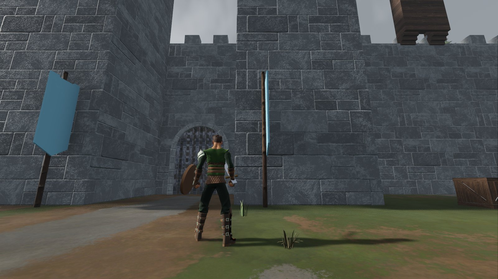
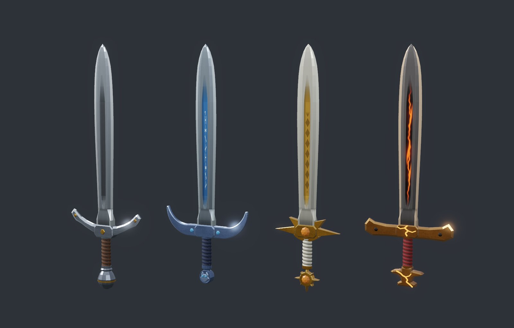

# Eldmark

**An open-source 3D medieval-fantasy MMORPG built with Godot 4.** A playable game with its own identity, and a reference architecture for authoritative-server action combat that you can study, fork or build on.


Three realms fight over the forts and castles of a central war zone. You pick a realm, level up inside its walls, and march out through its gate to take fortresses from the other two. Combat is third-person action in the style of New World: over-the-shoulder camera, crosshair aiming, no target lock, blocking and dodging. The server decides everything that matters; the client predicts what it can.

> **Status: pre-alpha, a playable vertical slice.** One real zone (the Vado Gris frontier, with a capturable fort), accounts and character saves through a separate platform service, and the full network and combat stack underneath. It is a prototype, not a finished game: most of the world, the third realm's content and the siege layer are still ahead (see [Roadmap](#roadmap)).
>
> **Language:** the code, comments and documentation are in English. The in-game interface text and the server log messages are still in Spanish; an English localization is planned.

## What works today

Everything below is in `main` and covered by the automated test suite.

- **Dedicated server per zone.** The same Godot project runs as a headless server (`--headless -- --server`). Each zone is its own map and its own process; there is no continuous world.
- **Authoritative networking.** Fixed 60 Hz ticks, binary protocol over ENet (optionally DTLS), snapshots at 30 Hz, **client-side prediction** with reconciliation for the local player, **interpolation** for everyone else, and **lag compensation**: the server keeps a short position history and rewinds hitboxes to what the attacker saw (up to 24 ticks, 400 ms). Rate limiting, input-window checks and a per-IP connection cap protect the server from malformed or abusive clients.
- **Action combat.** Sword and shield (light-attack combo, charged heavy attack, block with a parry window, dodge with invulnerability frames), bow (quick and drawn shots, projectiles simulated deterministically), three shield abilities and three bow abilities, two potions, weapon swap, stamina, knockdown (the "downed" state, revive and finisher). Fully data-driven from `data/combat/*.tres`.
- **NPCs and a boss.** A hierarchical-state-machine AI with navmesh pathing and attack tokens: the undead Hollows, realm guards, gate guardians and the Ford Captain.
- **Capturable fort.** The Vado Gris fort has a destructible gate, a capture circle, a garrison that changes hands, respawn waves inside owned forts, war alerts, a minimap and a capture HUD.
- **Social.** Realm-only chat (say, zone, whisper, party and system channels), parties, ignore and report, server-side filtering by realm, moderation sanctions.
- **Progression.** Races and character appearance, inventory with an authoritative ledger, currencies, levels and experience, starter templates (Squire with sword and shield, Marksman with bow).
- **Platform service in Go** (`platform/`, Go 1.24 on PostgreSQL 16): accounts with email verification and password reset, characters, hand-off tickets that let a zone admit a character, periodic persistence with integrity checks, an admin CLI, privacy tooling (data export and retention purges), and Docker-based deployment with backups. Optional: you can run the whole game without it.
- **Bots and load testing.** Full headless bot clients and a lightweight swarm that can load a zone with dozens of connections, a battery of cheating bots that checks the server cannot be fooled, and tools that compare the predicted and authoritative state bit by bit.
- **Tests and CI.** Over 2,800 test methods in about 210 files, including multi-process network tests, run on every push through GitHub Actions (see [docs/getting-started.md](docs/getting-started.md#continuous-integration)).

Not there yet, to be honest about it: the other two war-zone regions, siege weapons, the capital cities and PvE zones, Askarra gameplay content (the realm exists in the catalog and the realm-select screen, but the Vado Gris only admits Vardheim and Solmarch), classes beyond the two starter templates, guilds, and a polished art pass. Interest management is a stub that sends every entity to every client; a grid-based policy is designed but not built.

## Screenshots

| | |
|---|---|
|  |  |
| Sword-and-shield fight against the fort garrison | Capturing the Vado Gris fort for Vardheim |
|  |  |
| The Vardheim wall and camp, north end of the zone | Character creation (the interface is in Spanish for now) |

The swords are original models, one base design and one variant per realm:



## The world

Eldmark is set in **The Broken Crown**. The three peoples were once a single kingdom, Eld, ruled from the citadel of Aldcor, where the Flame of Eld burned. When the last king died without an heir the three lineages fought for the throne, the Flame burst, and the land cracked. The embers of the Flame still burn in the ruins and empower whoever holds them.

| Realm | Inspiration | Colors and emblem | Capital |
|---|---|---|---|
| **Vardheim** (north) | Norse and Anglo-Saxon clans: fjords, pine forest, tundra | Steel grey and ice blue; white wolf | Isenholm |
| **Solmarch** (southwest) | Gothic theocracy: fertile valleys, vineyards, slow rivers | White and gold; split radiant sun | Valcorin |
| **Askarra** (southeast) | Forgelords and merchants: red canyons, mesas, volcanic fields | Crimson and bronze; anvil over a burning crack | Kassar |

Each realm is enclosed by a wall with gates facing **Eldrun**, the central war zone, where the ruined citadel of Aldcor stands and where forts (small, quick objectives) and castles (large, with walls, gates and several lines of defense) can be captured and held. Realm-vs-realm combat happens there; inside a realm's own safe areas, enemies cannot hurt you. There is no diplomacy and no cross-realm chat: you see the enemy's body and banner, never their voice.

The first playable zone is the **Vado Gris** ("Grey Ford"), a compressed frontier of about 300 by 300 m between Vardheim's Frost Wall (north) and Solmarch's Dawn Wall (south), with a horseshoe river, a stone bridge and a wide ford, ruins on the flanks and a palisade fort on the central hill. Full lore and geography are in [docs/world.md](docs/world.md) and the zone notes in [docs/zonas/vado_gris.md](docs/zonas/vado_gris.md) (Spanish until translated).

## Quick start

You need:

- [Godot 4.7](https://godotengine.org/) (standard build, GDScript; 4.7.2 is what CI uses)
- [Git](https://git-scm.com/) and [Git LFS](https://git-lfs.com/): models, textures, audio and terrain data are stored in LFS

```bash
git clone https://github.com/Luisbh-dev/Eldmark
cd Eldmark
git lfs install
git lfs pull
```

### Try it in the editor

Open `project.godot` in Godot and press **F5**. This starts the offline sandbox in the Vado Gris: you appear in the Vardheim camp in front of the wall, with the fort across the river. There is no server in this mode, so no enemies and no other players; it is good for looking around and trying movement and camera.

### Play with a server

Run the following from the project root. `godot` stands for the Godot 4.7 console executable (see [getting started](docs/getting-started.md#running-godot-from-the-terminal) if it is not on your `PATH`).

```bash
# Everything in one command: starts a local server if none is running, then connects
godot --path . -- --local --realm=vardheim --name=Ana
```

Or run the pieces yourself, which is what you do for development and load tests:

```bash
# Terminal 1: a dedicated server for the Vado Gris, headless, with 8 fake players
godot --headless --path . -- --server --zone=vado_gris --port=24600 --fake-players=8

# Terminal 2: a player client
godot --path . -- --connect=127.0.0.1 --realm=solmarch --name=Ana

# Terminal 3: a headless bot that plays for 25 seconds and writes a JSON report
godot --headless --path . -- --bot --connect=127.0.0.1:24600 --bot-seed=3 \
    --quit-after-ticks=1500 --report=build/bot_3.json

# A swarm of 32 lightweight bots
godot --headless --path . -- --bots=32 --connect=127.0.0.1:24600 --bot-seed=1000 \
    --quit-after-ticks=3600 --report=build/swarm.json
```

Without a platform service, every client enters with a throwaway character that is lost on exit. To play with accounts and saved characters, run the Go platform service (`platform/deploy/dev.sh`) and start the client with `--title`. All options, debug panels, settings and the platform setup are in [docs/getting-started.md](docs/getting-started.md).

### Run the tests

```bash
godot --headless --path . --import                                  # import assets once
godot --headless --path . -s res://tests/run_tests.gd               # whole suite, exit code 0 if all pass
godot --headless --path . -s res://tests/run_tests.gd -- --filter=replay
```

The full suite takes a while (CI splits it into four parallel shards with `--shard=K/4`).

## Controls

Keys are bound to physical key positions, so WASD works on any keyboard layout. Defaults are registered at runtime by `scripts/client/input_bindings.gd`.

| Action | Default |
|---|---|
| Move | W A S D |
| Look | Mouse |
| Jump / Sprint | Space / Shift (hold) |
| Light attack (combo); hold for a charged heavy attack | Left mouse button |
| Block (a quick press just before a hit parries it) | Right mouse button |
| Dodge (in the direction you are moving) | Ctrl |
| Abilities of the equipped weapon | 1, 2, 3 |
| Swap weapon | Q |
| Health potion / stamina potion | R / T |
| Interact (hold to revive a downed ally or finish a downed enemy) | E |
| Swap camera shoulder / zoom | V / mouse wheel |
| Free the cursor while held / release the cursor until you click | Alt / Esc |
| Chat / party invite accept, decline | Enter / Y, N |
| Map (zoom with + and -) / scoreboard | M / Tab |
| Inventory / character window / social menu | I / C / G |
| Settings / controls help bar | F10 / F1 |
| Debug panels / network ghost (client) | F3 / F4 |

Chat commands (`/r`, `/ignorar`, `/reportar`, ...) are in Spanish for now. The `--demo` flag plays a scripted route and combat for recording captures; see [getting started](docs/getting-started.md#offline-sandbox-and-startup-options).

## Project structure

```
assets/        Models, animations, textures, materials, audio, UI theme, emblems (binaries in Git LFS)
addons/        Third-party plugins (Terrain3D, ProtonScatter)
data/          Game data as .tres resources: combat catalog, NPCs, items, fortresses, races, level curve
docs/          Design and technical documentation (see the index below)
platform/      Accounts, characters and persistence service in Go (not scanned or exported by Godot)
scenes/        Godot scenes: boot, characters, client roots, UI, world and zones, VFX
scripts/
  shared/      Simulation and protocol, loaded by both client and server
  server/      Authoritative server logic, AI, persistence glue
  client/      Camera, input, UI, audio, animation, bots
  world/       Nodes used by zone scenes
tests/         Automated tests: run_tests.gd, test_*.gd and the network harness
tools/         Generators, quality bench, load tests, balance and state-log tools, export scripts
```

One Godot project holds client and server. `scripts/shared/` never depends on `scripts/client/` or `scripts/server/`, and server and client never depend on each other; `tests/test_architecture.gd` enforces it. More in [docs/architecture.md](docs/architecture.md).

## Why Eldmark as a base

If you want to build your own networked action game in Godot, the parts of Eldmark that are hardest to get right are written down and tested:

- **A deterministic shared simulation** (`scripts/shared/`) that the server and the predicting client run bit for bit, with no clock, input or scene-tree access. Reconciliation compares encoded state exactly, and a test fails on any unexplained divergence. See [docs/networking.md](docs/networking.md).
- **Prediction, interpolation and lag compensation** built on ENet with explicit ticks instead of Godot's high-level multiplayer: tick synchronization, input windows, snapshot priority under a byte budget, rewound hit checks with cheat-resistant limits.
- **An action-combat state machine** driven by `.tres` data, shared by client and server, with abilities, status effects, projectiles and a deterministic balance tool. See the [combat section](docs/architecture.md#combat) of the architecture overview and [docs/abilities.md](docs/abilities.md).
- **A test harness** that runs a server and several clients in a single process, or as real processes, with a network simulator (latency, jitter, loss, duplication) and cheating bots.
- **A server/platform split** with a small Go service for accounts and persistence, signed hand-off tickets, and the design notes for privacy and operations. See [docs/platform.md](docs/platform.md).
- **Measured limits**: load-test tooling and recorded results for how many combatants one zone process sustains (40 per battle at the moment).

The design documents are long and written as decision records, including what was tried, what failed and what is still provisional. They are the best place to understand why things are the way they are.

## Documentation

| Document | Contents |
|---|---|
| [docs/getting-started.md](docs/getting-started.md) | Running the game, server, bots, platform, tests, CI and export |
| [docs/architecture.md](docs/architecture.md) | Architecture overview for contributors and people building on Eldmark |
| [docs/vision.md](docs/vision.md) | Game vision, realms, war zone, combat pillars, roadmap |
| [docs/world.md](docs/world.md) | Lore, geography and world structure |
| [docs/networking.md](docs/networking.md) | Protocol, ticks, prediction, interpolation, lag compensation, security, budgets |
| [docs/abilities.md](docs/abilities.md) | Abilities, status effects, weapons and projectiles |
| [docs/fortress.md](docs/fortress.md) | The capturable fort: state, gate, NPC garrison, alerts, siege bots |
| [docs/progression.md](docs/progression.md) | Items, inventory, currencies, levels, races and appearance |
| [docs/social.md](docs/social.md) | Chat, parties, moderation and what crosses between realms |
| [docs/platform.md](docs/platform.md) | Accounts, tickets, persistence, privacy, deployment |
| [docs/art.md](docs/art.md) | Art direction and asset plan |
| [docs/history/](docs/history) | Archived reports from past work sessions |

The following documents are still in Spanish and are being translated: [docs/combate.md](docs/combate.md) (combat design), [docs/zonas/](docs/zonas) (zone notes), [docs/calidad.md](docs/calidad.md) (visual quality plan) and [docs/backlog.md](docs/backlog.md) (the master task list, with what is done and what is next).

## Contributing

Contributions are welcome, from bug reports to new content. Read [CONTRIBUTING.md](CONTRIBUTING.md) first. The short version:

- Open an issue before starting anything large, so we can agree on the approach.
- Follow the official GDScript style guide: `snake_case` files and variables, `PascalCase` `class_name`, tabs, **static typing everywhere**. Identifiers and comments are in English.
- Keep the dependency rules between `scripts/shared`, `scripts/server` and `scripts/client`.
- Add tests with your change and make sure the suite passes headless. Scenes and resources must stay in text format (`.tscn`, `.tres`).
- Any third-party asset must be redistributable and recorded with its author, version, URL and license.

## Roadmap

The long-term plan, from [docs/vision.md](docs/vision.md). The first four steps are in place; the master task list is [docs/backlog.md](docs/backlog.md).

1. Character and camera: WASD movement and an over-the-shoulder action camera. **Done.**
2. Networking: dedicated server, several players, prediction and interpolation, realm selection. **Done.**
3. Action combat: attacks, block, dodge, stamina, lag compensation, death and respawn. **Done.**
4. First capturable fort on a small frontier map. **Done** (Vado Gris).
5. Accounts, characters and database persistence. **Implemented** (platform service and title screen); no public deployment yet.
6. First realm: capital city, a PvE zone, wall and gate. **Planned.**
7. Full war zone: several forts and castles, siege weapons, rewards.
8. All three realms and scaling across several servers.

In parallel: a visual quality pass (animation, map, HUD, hit feel, scenery), an English localization of the interface, and exports for closed tests (export presets for a Windows client and a Linux server already exist).

## License

- **Code** (GDScript, Go, Python, shaders and tooling): [MIT](LICENSE).
- **Original assets made by this project** (the sword models, interface icons and emblems, sound effects, visual effects, materials and zone maps): [CC BY 4.0](LICENSE-ASSETS.md). The file lists exactly which folders it covers.
- **Third-party material keeps its own license** and is not relicensed: the addons in `addons/` (MIT), and the CC0 asset packs listed below. Details and per-folder scope are in [LICENSE-ASSETS.md](LICENSE-ASSETS.md) and the per-pack records in `assets/LICENCIAS.md` (which is in Spanish for now).

## Third-party credits

Eldmark stands on the work of others. These are included in the repository today:

- **[Terrain3D](https://github.com/TokisanGames/Terrain3D)** 1.0.2, by Cory Petkovsek, Roope Palmroos and contributors. MIT.
- **[ProtonScatter](https://github.com/HungryProton/scatter)** 4.2.0, by HungryProton. MIT.
- **[Quaternius](https://quaternius.com)**: Universal Animation Library 1 and 2, Universal Base Characters, Modular Character Outfits (Fantasy), Medieval Village MegaKit and Stylized Nature MegaKit (the free Standard editions). CC0 1.0.
- **Castle Wall Kit** by [loafbrr](https://loafbrr.itch.io/castle-wall-kit). CC0 1.0.
- **Castle Kit** by [Kenney](https://www.kenney.nl). CC0 1.0.
- **Hand-Painted Watercolor Terrain Texture Pack** by Jonas Voland (Voxel Core Lab). CC0 1.0.
- The Terrain3D binaries are built with [godot-cpp](https://github.com/godotengine/godot-cpp) (MIT, Godot Engine contributors), and the game runs on the [Godot Engine](https://godotengine.org) (MIT).

Credit is not required for the CC0 material, but it is deserved. The full table, with licenses and the folders each one covers, is in [LICENSE-ASSETS.md](LICENSE-ASSETS.md).

Eldmark is an independent project and is not affiliated with Amazon Games or New World; the combat style is cited only as a reference.
