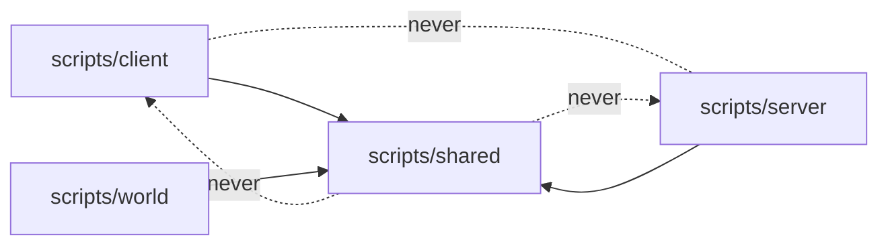
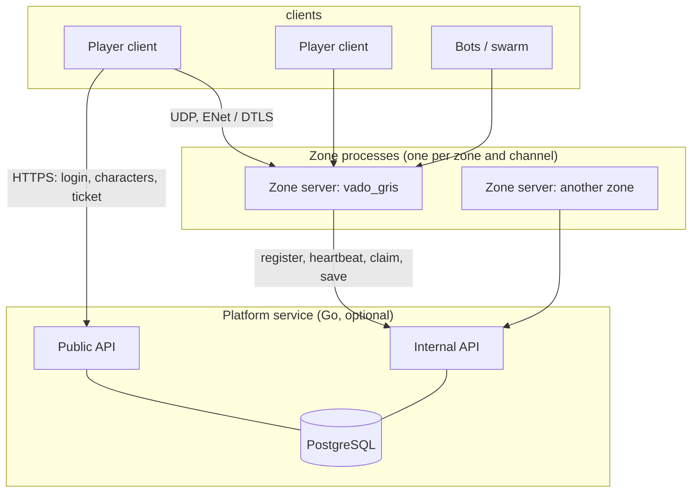
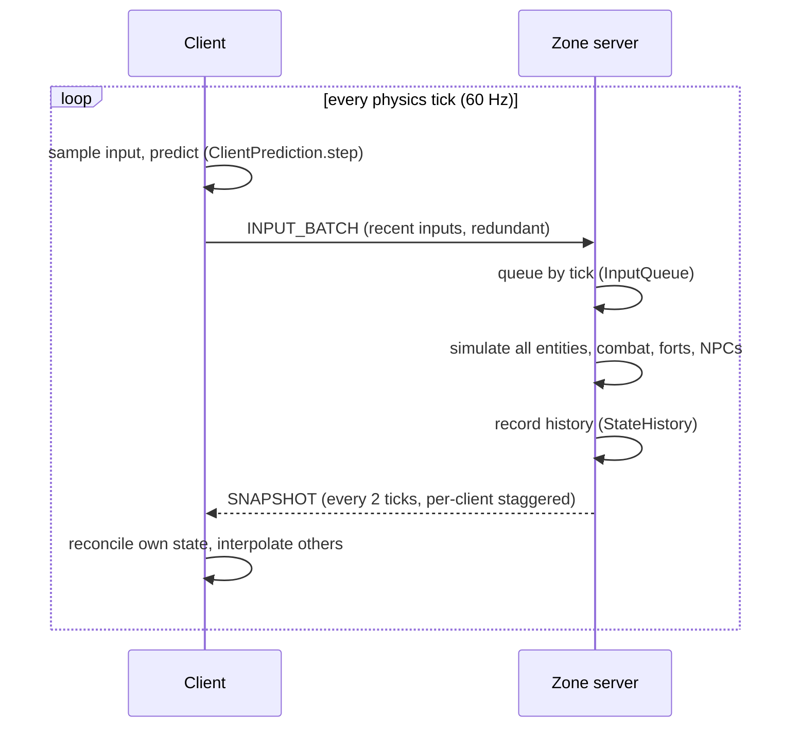

# Architecture

An overview of how Eldmark is put together, for people who want to contribute and for people who want to use it as a base for their own networked Godot game. It explains the shape of the system and where to find things; the detailed design documents (linked throughout) hold the exact formats, numbers and the reasoning behind every decision.

Everything described here exists in `main` unless it says "planned".

Contents:

1. [Principles](#principles)
2. [One project, three roles](#one-project-three-roles)
3. [Dependency rules](#dependency-rules)
4. [Zones and processes](#zones-and-processes)
5. [Network flow](#network-flow)
6. [The shared simulation](#the-shared-simulation)
7. [Combat](#combat)
8. [NPCs and forts](#npcs-and-forts)
9. [Client presentation](#client-presentation)
10. [Social, progression and the platform](#social-progression-and-the-platform)
11. [Testing](#testing)
12. [Tools](#tools)
13. [Where to start reading](#where-to-start-reading)

## Principles

- **Authoritative server.** The client sends intents (inputs, ability presses); the server decides every result. The client never sends a position, a health value or a hit.
- **Zones, not a continuous world.** Each zone is an independent map with its own server process. Crossing a wall gate means a short load. This is simpler, scales better and avoids the numerical-precision problems of huge maps.
- **Everything in integer ticks at 60 Hz.** Simulation, protocol, queues and the network simulator are all measured in ticks. Code in `scripts/shared/` never reads a clock, so runs are reproducible from a seed.
- **Determinism where prediction needs it.** With the same binary and OS the server and the predicting client reach the same bits; across platforms, reconciliation still works because it re-simulates on any difference.
- **One project for client and server.** The dedicated server is the same Godot project started with `--headless -- --server`.
- **Measure from the start.** Metrics, load tests and per-section tick timing exist since the first networking phase, because the war zone is the most demanding map in the game.

## One project, three roles

```
scripts/
  shared/   simulation, protocol, data classes, formulas      (loaded by both sides)
  server/   authoritative zone server, combat resolution, AI, fort logic, persistence glue
  client/   camera, input, UI, audio, animation, bots, platform API client
  world/    nodes used by zone scenes (ZoneRoot, FortGate...)  (loaded by both sides)
```

`scenes/boot.tscn` (script `scripts/boot.gd`) is the main scene. It reads the command line and starts the server (`--server`) or hands over to the client launcher, which picks the sandbox, a network client, a bot, a swarm, `--local`, or the title screen. `boot.gd` names no class from `scripts/client/`, so the server never loads UI or audio code by accident.

## Dependency rules

These rules keep the server loadable without a display and the simulation deterministic. They are enforced by `tests/test_architecture.gd`, which analyzes script text (without comments) and the dependency tree of every zone scene, so they cannot rot silently:



- `scripts/shared/` and `scripts/world/` cannot depend on anything in `scripts/client/` or `scripts/server/`, by path or by `class_name`.
- `scripts/shared/` cannot use `Input`, `InputMap`, cameras, UI, `DisplayServer` or the clock.
- `scripts/server/` and `scripts/client/` do not depend on each other.
- Zone scenes, the player scene and the server scene cannot pull in client scripts, animations, character visuals, UI scenes or audio, so a server export can strip them.
- Audio is client-only. The server never plays animations.

The consequence for anyone building on this: put anything the server and the predicting client must agree on in `shared/`; put presentation in `client/`.

## Zones and processes



- The zone registry is `scripts/shared/zones.gd`: zone id, scene, PvP mode (`SAFE` or `RVR`), default capacity and, through `RealmCatalog`, which realms a zone admits. Today there are two zones: `vado_gris` (the real one) and `test_world` (a test circuit).
- A zone process owns its map, its NPCs, its fortresses and its connected players. State that must outlive the process (characters, fortress ownership) goes to the platform.
- Without the platform, the server runs standalone: clients get a throwaway character. This is the default for development and for most tests.

## Network flow

The design is in [networking.md](networking.md). The short version:

**Transport.** `ENetMultiplayerPeer` and `SceneMultiplayer` are used only to connect, authenticate and move raw binary packets. No RPCs, `MultiplayerSynchronizer` or `MultiplayerSpawner`: prediction, interpolation and rewind need an explicit tick on every datum and exact control of the bytes. Everything goes through `NetTransport`. Three channels: inputs, snapshots and reliable messages. The server wraps the engine peer in `GuardedEnetPeer`, which discards anything that is not the protocol before the engine logs an error per packet. Optional DTLS secures the zone port. The protocol is versioned (`NetProtocol.PROTOCOL_VERSION`) and a client with another version is rejected at the handshake.

**The tick loop.** Both sides poll at the start of their physics tick and flush at the end: receive, simulate, send.



**Inputs.** The input of tick T is applied at server tick T, one per player per tick. The client runs slightly ahead of the server so that its inputs arrive in time. `TickSync` measures how early they arrive (each snapshot carries `input_margin`) and the client speeds up, slows down or resynchronizes accordingly. If an input does not arrive in time the server substitutes a repeat of the last one and counts it.

**Snapshots.** At 30 Hz, staggered per client, capped at 1,200 bytes, with a priority accumulator: what has gone longest without being sent goes first. The snapshot includes the acknowledged input tick and the authoritative state of the receiving player. Spawns, despawns, events (hits, deaths, fort state changes, chat and party messages) travel on the reliable channel. `InterestPolicy` decides what each client receives; today it is the base policy that sends every entity (a grid-based policy is designed but not built).

**Client-side prediction and reconciliation.** `ClientPrediction` simulates the local player with the same `PlayerCharacter.simulate()` the server runs. When a snapshot arrives with the authoritative state for tick N, the client compares it with what it predicted for N by comparing the encoded bytes exactly. On a match nothing happens. On a mismatch it rewinds to the server state and re-simulates the pending inputs, and `CorrectionSmoother` hides the visual jump. The client report counts exact matches, explained differences (the server substituted an input) and unexplained ones, which indicate a determinism bug, and a test fails on any of those.

**Interpolation.** Remote players are drawn 70 to 200 ms in the past. `RemoteInterpolator` keeps a ring of samples per entity and interpolates linearly (extrapolating at most 6 ticks if data is late). The interpolation delay adapts to measured jitter. A remote player's body never calls `simulate()`; the same animation layer drives local and remote characters.

**Lag compensation.** `StateHistory` keeps about one second of positions per entity on the server. When an attack's inputs are processed, `CombatResolver` rewinds target hitboxes to the tick the attacker was seeing, which is derived from the interpolation delay the client declares, clamped by what the server itself measures (RTT, input lead), up to a hard cap of 24 ticks (400 ms). A client that declares more than the cap plus a small slack has its hit rejected and a suspicion counted. Rewind is on the server only; the client predicts feedback and confirms it from authoritative events.

**Security.** Input window and button mask validation, per-peer packet and byte limiters, warnings for malformed or out-of-state packets with a kick at 50 warnings in 600 ticks, a per-IP connection cap, realm validation at login, and signed hand-off tickets when the platform is in use. The cheating bot (`--bot-cheat`) exists to prove each of these in the test suite.

Measured budgets (bandwidth per client, tick time per section, the per-battle player limit) are in section 14 of [networking.md](networking.md); the measuring tools are in [getting-started.md](getting-started.md#load-tests).

## The shared simulation

`PlayerCharacter` (`scripts/shared/player_character.gd`) is a `CharacterBody3D` whose `simulate(input, delta)` is the single movement and combat step used by the server for every entity and by the client for prediction. `PlayerInput` and `PlayerState` define what goes in and what comes out, with `encode()` and `decode()` to and from bytes. The server rounds any state it imposes (spawn, teleport) through `encode` and `decode`, and the yaw is rounded to 32-bit float, so both sides compare exact bits. Characters do not collide with each other, which keeps one player's simulation independent of the others.

Other things that live in `scripts/shared/`: the protocol (`net/`), the combat rules and catalog (`combat/`), realm and fortress rules (`war/`), items, inventory, currencies, levels, races and appearance (`progression/`), chat channel and party rules (`social/`), NPC definitions (`ai/`), name rules and the bot brain. All of it is plain, testable code with no dependency on the client (camera, UI, input); only `net/` and parts of the simulation touch the scene tree or physics.

## Combat

Design docs: [combat.md](combat.md) and [abilities.md](abilities.md).

- **Data first.** Weapons, attacks, abilities, status effects, projectiles, dodges, templates and NPC attacks are `.tres` resources in `data/combat/`. `CombatCatalog` loads them once, assigns stable ids, converts seconds to ticks and bakes the dodge and lunge curves into `AttackTicks`, `AbilityTicks`, `ProjectileTicks` and friends.
- **One state machine, two places.** `ActionMachine` in `shared/combat/` advances a `CombatState` (action, phase, stamina, cooldowns, equipped weapon) inside `simulate()`. The client predicts the cosmetic result; the server decides whether the action happens and what it hits. Light attacks chain into a combo, a held press charges a heavy attack, block has a 120-degree arc and a short parry window, dodge grants invulnerability frames, and stamina gates the expensive actions.
- **Hit resolution on the server.** `CombatDirector.process_tick()` runs, in a fixed order each tick: freeze active hits, spawn projectiles and effects, resolve hits (`CombatResolver`, with rewind, using `HitShapes` and line-of-sight checks), apply results (`DamageFormula`, block, control effects, interrupts, knockdowns, deaths), status effects, the downed state (bleed-out, revive, finisher), environment hazards and respawns, then publish health. Hits within a tick are simultaneous and applied in `net_id` order.
- **Projectiles.** Arrows are ballistic and deterministic from a canonical camera ray (yaw, pitch, shoulder bit); the server simulates them (`ProjectileSystem`) and the client computes the flight from the spawn event instead of receiving per-tick positions.
- **Feedback.** The client plays hit effects, damage numbers, hit markers, trail, sounds and screen feedback from authoritative events, and animates through a combat clip layer that is shared by local and remote characters. Animation is never allowed to move the character: clips are root-motion free and movement comes from the simulation. A few cosmetic parts of your own hits (spark, impact sound, hit stop) are predicted locally; see [Client presentation](#client-presentation).
- **Balance.** `tools/combat_balance.gd` measures DPS, time to kill and duels deterministically from the data files.

## NPCs and forts

Design docs: [fortress.md](fortress.md) and [world.md](world.md).

- **NPC AI.** A hierarchical state machine (`HfsmBrain`, parameters in `NpcDefinition` resources under `data/npcs/`) with server-side navigation on a baked navmesh (`NpcNavigation`, `tools/bake_navmesh.gd`), attack tokens that limit how many NPCs attack one target at once, telegraphed heavy attacks, and spawners with respawn timers. NPCs are net entities like players: their brain pushes an input into the same `InputQueue` and the same `simulate()` runs. The catalog today: the Hollow (undead garrison), realm guards, gate guardians and the Ford Captain, the first boss.
- **Fortress.** `FortressState` and `FortressDefinition` in `shared/war/` are pure logic (owner, capture progress, captain alive, gate health, consolidation timer). `FortressController` in `server/war/` feeds them with who stands in the capture circle each tick, drives the destructible gate (`StructureTarget`, `FortGate`), emits war events and fort object state, awards capture rewards and updates the scoreboard. A garrison of the owning realm spawns after a consolidation period, the fort becomes a respawn point, and with a platform the owner is persisted (`FortressPersistence`).
- **Siege bots.** Bots built on `BotBrain` can fight for a fort, and `tools/war/` runs siege battles with them so that capture logic is tested without people.

## Client presentation

Everything the player sees and hears lives in `scripts/client/`, `assets/`, `scenes/` and the zone generators in `tools/`. None of it can change the simulation: the dependency rules above keep it out of `scripts/shared/` and `scripts/server/`, and the server never loads it. The design record, with the criteria each piece is checked against, is [quality.md](quality.md).

- **Feedback hub.** `CombatFeedback` turns the authoritative events (hits, blocks, deaths, knockdowns) into presentation at their draw tick, and re-emits them as signals that the effects (`CombatVfx`, `SwordTrail`, `ChargeAura`), the audio (`CombatAudio`) and the HUD (`HitMarker`, `DamageNumbers`, `DamageIndicator`) subscribe to. For the local player's own attacks it also runs a purely cosmetic prediction: when the local sector check against the drawn positions says the swing connects, it plays the spark, the impact sound and a hit stop of 50 ms (light) or 80 ms (heavy). The hit stop freezes only the animation (the attacker's, and the victim's on a parry or a killing blow), never the simulation. If the server then confirms a normal hit, nothing is repeated; if it does not, nothing was lost but a spark. Damage numbers, the hit marker and the DPS meter always wait for the server.
- **Animation stack.** A locomotion `AnimationTree`, then a chain of `SkeletonModifier3D`s: `ArmedStanceModifier` (the shield guard at rest and an arm layer while moving, so unarmed locomotion clips do not swing the sword behind the head), `CombatPoseModifier` (attack, dodge and block poses from the combat clip layer, which reads `data/animation/*_clips.tres`; during an attack the feet stay planted and hips and legs come from the clip), `HitReactionModifier` (a procedural flinch on every hit and a push of the shield arm on blocked hits) and `SpineTwistModifier` (aiming). `CharacterAnimator` adds the dead-body slide, the stagger step and the signals for footsteps, jumps and landings. `NpcVisualProfile` gives each NPC type its look (the Hollow without a shield and with a zombie walk, the Ford Captain scaled up and recolored) through the same `HumanoidVisual` that draws players.
- **Audio.** `AudioDirector` owns the buses (`default_bus_layout.tres`) and a pool of voices per category. `CombatAudio` asks it for sounds from `CombatSoundBank` (banks of variants per material, with random pitch and volume, levels in `assets/audio/sfx/niveles.json`). Swings are requested early enough that the sound's peak falls in the middle of the active window, and `FootstepSurface` picks the footstep from the `surface` metadata of the collider under the feet or, failing that, from the name of the Terrain3D texture painted there.
- **Interface.** `UIPalette` holds the colors (one color per meaning: red is damage, amber is NPC danger, one hue per realm), `UIThemeBuilder` generates `assets/ui/theme/eldmark_theme.tres` from it, `UIFonts` gives the three fonts to the code that draws text by hand, and `GameIcon` loads the original icons of `assets/ui/icons/`. The war HUD (`scripts/client/war/`) has the fort panel, the compass, `WorldMarkers` and `ObjectiveLine`, the kill feed, the boss bar, `WarBanners` (a queue of notices, one at a time) and `TelegraphMarks` (ground marks of NPC attacks, filled by the predicted tick so that they are full on the last tick when dodging still works).
- **Maps.** A zone's map is a `ZoneMapDefinition` (scale, fixed places, image), baked from the scene by `tools/map/bake_parchment_map.gd` into `assets/maps/`. `Minimap` and `WorldMap` draw it; `ZonePlaces` and `MapLabelPlacer` position and de-overlap the place names. The same source of markers (`MarkerSource`) feeds the minimap, the map window, the compass and the world markers.
- **Scenery.** The environment (`assets/environments/vado_gris_frontier.tres`: sky, fog, lighting, tone mapping), the original sky shader (`storm_sky.gdshader`), the Terrain3D texture set, the grass materials and the zone scene are generated by `tools/terrain/generate_vado_gris.gd` and its helpers, so they can be rebuilt and the numbers stay in one place. The keep (`scenes/world/props/fort/fort_keep.tscn`, `scripts/world/fort_keep.gd`) is in `scripts/world/` because it carries the collision layer the simulation walks on; its visual parts are only materials and levels of detail. Walls, towers and gates are tagged by `WallLightTag` so that two mirrored fill lights touch only them.

Two rules hold across all of this. Presentation never decides anything (the exceptions above are cosmetic and reversible), and it is verified with captures from the quality bench (`tools/quality/`, see [getting-started.md](getting-started.md#quality-capture-bench)) next to the unit tests that check the logic around it (`tests/test_combat_feel.gd`, `tests/test_combat_sound_bank.gd`, and so on).

## Social, progression and the platform

- **Social.** All server logic is in `scripts/server/social/` (`SocialService`, `ChatRouter`, `PartyManager`, `ModerationService`). Recipient lists are filtered by realm before sending, never at display time. Rate limits and sanitizing live in `ChatRouter`. Design and what crosses between realms: [social.md](social.md).
- **Progression.** Item definitions, inventory operations, currencies, level curve, races and appearance are shared (`shared/progression/`), so the client can display and the server can validate with the same code. The server owns the inventory (`ProgressService`) and keeps an economy ledger. Design: [progression.md](progression.md).
- **Platform service.** `platform/` is a Go module (Go 1.26, PostgreSQL 16) with packages for accounts, characters, tickets, zones, persistence, progress, social moderation, privacy, admin, mail and deployment. A client logs in over HTTPS, picks a character and receives a short-lived signed ticket; the zone server claims it through the internal API, keeps a lease on the character, and saves progress at checkpoints and on exit. Saves are validated (checks S1 to S8) before being applied. Game data that both sides need (progression rules, races, items) is exported from Godot to a JSON file the Go service embeds (`tools/progression/export_rules.gd`, with a test that fails when it is stale). Design, API and operations: [platform.md](platform.md).

## Testing

`tests/run_tests.gd` is a custom headless runner. It discovers `tests/test_*.gd` files (each extends `TestCase`), runs their `test_*` methods with optional `before_each` and `after_each`, supports `await`, and fails a test if a script or engine error is logged during it. There are 221 files and 2,993 test methods today.

- **Unit tests** for the pure shared and server pieces.
- **In-process network tests.** `tests/net_harness.gd` runs a `ZoneServer` and several `NetClient`s in one process, each in its own `SubViewport` with its own physics world and its own `NetTransport`, with a network simulator for latency, jitter, loss and duplication.
- **Multi-process tests.** Real Godot processes for the server, bots, swarms and cheating bots, reading their JSON reports.
- **Architecture tests** (`tests/test_architecture.gd`) for the dependency rules.
- **Fixtures and probes** (`combat_fixture.gd`, `fortress_fixture.gd`, `zone_fixture.gd`, `prediction_pair.gd`, `fake_zone_platform.gd`...) that other tests reuse. `FakeZonePlatform` lets the zone server be tested with accounts and tickets without Go.
- **Go tests** in `platform/` (about 300) run against an ephemeral PostgreSQL, plus end-to-end tests (`platform/e2e`) with real zones and bots.
- **Presentation tests** that need no window: sound banks and levels, hit feel, the layout of nameplates, map labels and the HUD, the armed-stance and reaction modifiers, and the capture bench scripts. What only a screen can show is checked with the capture bench.

CI runs the suite in four shards plus a Windows job, the Go checks and the end-to-end job. Details and the commands are in [getting-started.md](getting-started.md#continuous-integration).

## Tools

`tools/` holds scripts that are not part of the game but that the project depends on:

| Folder or file | Purpose |
|---|---|
| `load_test.gd`, `load_test_summary.gd` | Load scenarios with fake players and bot swarms, with pass/fail criteria |
| `compare_state_logs.gd`, `state_log_comparer.gd` | Cross-check server and bot state logs bit by bit |
| `combat_balance.gd` | Deterministic DPS, time-to-kill and duel measurements |
| `quality/` | Capture bench: animation strips, UI, world, combat and video, plus scripts that join before and after captures side by side |
| `war/` | Siege battle runners and summaries |
| `progression/` | Export of the progression rules to the platform; save fixtures |
| `terrain/`, `props/`, `materials/`, `map/`, `vfx/`, `ui/`, `audio/` | Generators for the Vado Gris terrain, props, materials, the parchment zone map, effects, UI theme and icons, and synthesized sound effects (`audio/` also builds a listening sheet to compare alternatives) |
| `blender/`, `assets/`, `animation/`, `render/` | Asset pipeline helpers: the original sword and fort-keep models, kit mesh extraction, terrain texture processing, grass materials, animation clip analysis (`animation/`), review renders |
| `export.sh`, `export.ps1` | Client and server exports |
| `check_secrets.sh` | CI check that no secrets are tracked |
| `i18n/` | Helpers used for the English translation of comments |

## Where to start reading

| If you want to... | Read |
|---|---|
| Understand the netcode end to end | [networking.md](networking.md), then `scripts/server/zone_server.gd` (the header documents the tick order) and `scripts/client/net_client.gd` |
| See how prediction stays in sync | `scripts/client/client_prediction.gd`, `tick_sync.gd`, `correction_smoother.gd`, and `tests/prediction_pair.gd` |
| Follow a hit from click to damage number | `scripts/shared/combat/action_machine.gd`, `scripts/server/combat_resolver.gd`, `combat_director.gd`, `scripts/client/combat_feedback.gd` |
| Add a weapon or ability | the `.tres` files in `data/combat/`, `CombatCatalog`, then [abilities.md](abilities.md) |
| Add a zone | `scripts/shared/zones.gd`, the Vado Gris scene and [zones/vado_gris.md](zones/vado_gris.md) |
| Add an NPC | `data/npcs/`, `scripts/shared/ai/npc_definition.gd`, `scripts/server/ai/` |
| Work on accounts and saves | [platform.md](platform.md), `platform/internal/`, `scripts/server/platform/` |
| Understand the presentation layer | [Client presentation](#client-presentation), `scripts/client/combat_feedback.gd`, `scripts/client/humanoid_visual.gd` and [quality.md](quality.md) |
| Know what is planned | [vision.md](vision.md) and [backlog.md](backlog.md) (the master task list) |
