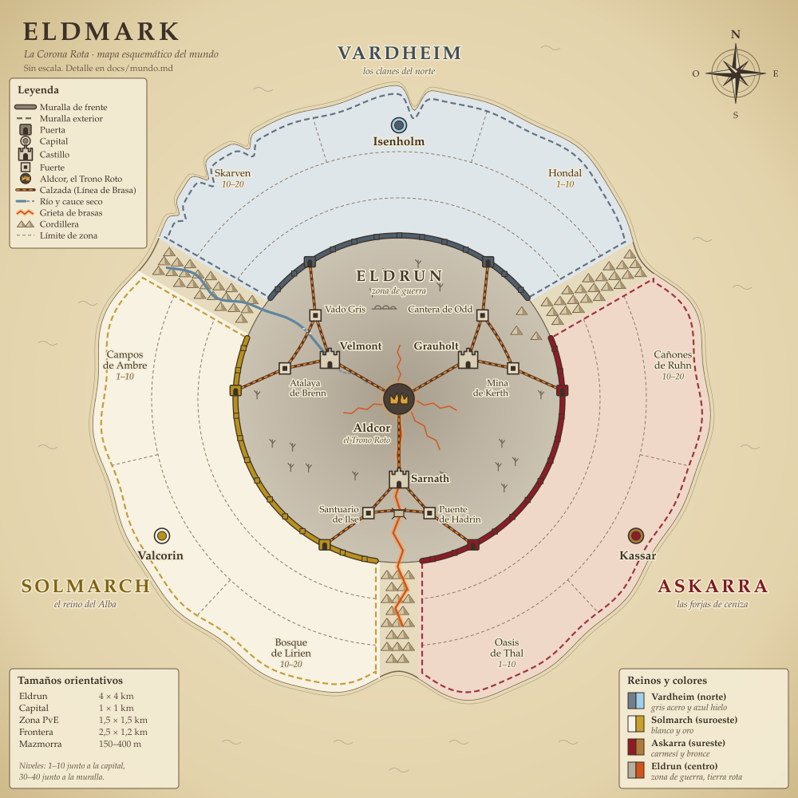

# Eldmark: el mundo de La Corona Rota

> Estado: **mundo elegido**, La Corona Rota (propuesta C). Este documento recoge
> la historia, los reinos, la zona de guerra, la estructura técnica del mundo,
> la identidad visual de cada reino y el plan para construirlo en Godot 4.7.
> Mapa: [mapa_mundo.svg](mapa_mundo.svg).

## Historia

Hace tres siglos los tres pueblos formaban un solo reino, **Eld**, gobernado
desde **Aldcor**, la ciudadela donde ardía la **Llama de Eld**: un fuego antiguo
que fertilizaba la tierra y ataba a los tres linajes por juramento.

El último rey murió sin heredero y los tres linajes reclamaron el trono. En la
batalla de Aldcor la Llama estalló, la ciudadela se hundió y la tierra se
agrietó: **la Quiebra**. Cada pueblo se encerró tras su muralla culpando a los
otros.

Las **Brasas de Eld**, esquirlas de la Llama, siguen ardiendo entre las ruinas y
dan poder a quien las controla. Se dice que quien reúna suficientes reavivará la
Llama y ceñirá la Corona Rota. La zona de guerra es el cadáver del reino que
fueron: un pasado común que solo uno puede heredar.

## Los tres reinos

### Vardheim, los clanes del norte
- **Cultura:** clanes de inspiración nórdica y anglosajona. Un consejo de jarls
  elige al rey. Fueron los Escuderos de Eld, guardianes del trono.
- **Paisaje:** fiordos, pinares, tundra y glaciares; inviernos largos y auroras.
- **Arquitectura:** casas largas de madera oscura con tejado de tablas,
  empalizadas, torres de piedra tosca y tallas de nudos.
- **Heráldica:** gris acero y azul hielo. Un lobo blanco sobre campo gris.
- **Capital:** Isenholm, una fortaleza al fondo de un fiordo.
- **Tono:** fatalista y duro. Juraron custodiar el trono y fallaron.

### Solmarch, el reino del Alba
- **Cultura:** teocracia gótica gobernada por la Orden del Alba y una nobleza
  caballeresca.
- **Paisaje:** valles fértiles, viñedos y ríos lentos; clima templado y lluvioso.
  Al este, pantanos envenenados por la Quiebra.
- **Arquitectura:** caliza clara, catedrales con arbotantes, castillos de torres
  cónicas con pizarra azul y vidrieras.
- **Heráldica:** blanco y oro. Un sol radiante partido en dos.
- **Capital:** Valcorin, una ciudad-catedral en un meandro.
- **Tono:** fe luminosa que acaba en fanatismo. Ven la reconstrucción de la
  Llama como una cruzada.

### Askarra, las forjas de ceniza
- **Cultura:** oligarquía de señores forjadores y mercaderes, con ideas
  bizantinas y mediterráneas sin copiar ninguna cultura real.
- **Paisaje:** cañones rojos, mesetas, oasis y campos volcánicos; calor seco y
  lluvias de ceniza. Aquí las grietas de la Quiebra todavía arden.
- **Arquitectura:** arenisca roja y terracota, cúpulas bajas, arcos, ciudades
  escalonadas talladas en la roca y chimeneas de forja.
- **Heráldica:** carmesí y bronce. Un yunque de bronce sobre una grieta en llamas.
- **Capital:** Kassar, "la de los mil escalones", tallada en un cañón.
- **Tono:** pragmático y desesperado. Su tierra se muere y solo las Brasas la
  mantienen viva.

**Assets:** un único kit modular low-poly CC0, recoloreado por reino: madera
oscura y piedra gris para Vardheim, caliza y pizarra azul para Solmarch,
arenisca y terracota para Askarra. El detalle está en
[Identidad visual](#identidad-visual).

## Geografía



Mapa esquemático, sin escala: [mapa_mundo.svg](mapa_mundo.svg). Los tamaños
reales de cada zona están en [Escala](#escala).

Los reinos forman un triángulo: **Vardheim al norte, Solmarch al suroeste y
Askarra al sureste**, con la zona de guerra, **Eldrun**, en el centro. Cada
muralla rodea su reino entero. Los tramos exteriores se apoyan en el mar, las
montañas o el desierto; el tramo que mira a Eldrun es el frente y tiene dos
puertas. Entre cada par de reinos, una cordillera infranqueable baja desde la
costa hasta Eldrun, así que los reinos solo se tocan a través de la zona de
guerra.

| Reino | Muralla | Puertas |
|---|---|---|
| Vardheim | Muro de Escarcha (piedra seca y troncos) | Puerta del Lobo, Puerta de Hrafn |
| Solmarch | Muralla del Alba (caliza y torres cónicas) | Puerta Áurea, Puerta de los Penitentes |
| Askarra | Cinturón de Bronce (arenisca reforzada) | Puerta de Ceniza, Puerta del Cañón |

| Nivel | Vardheim | Solmarch | Askarra |
|---|---|---|---|
| Capital | Isenholm | Valcorin | Kassar |
| 1–10 | Hondal: valle de pinos y granjas | Campos de Ambre: viñedos y trigales | Oasis de Thal: regadío entre cañones |
| 10–20 | Skarven: fiordos y naufragios | Bosque de Lirien: bosque caducifolio y abadías | Cañones de Ruhn: mesetas y minas |
| 20–30 | Grimfell: tundra alta y túmulos | Ciénaga de Morvel: pantano corrompido | Yermo de Ceniza: campos volcánicos y grietas vivas |
| 30–40 | Marca del Lobo: bosque quemado junto al muro | Llanos del Penitente: campamentos de cruzada | Forjas de Ossar: fundiciones fronterizas |

## Zona de guerra: Eldrun, la Corona Rota

**Bioma:** tierras rotas y grises, colinas peladas, bosques muertos, ríos secos y
grietas que brillan con brasas anaranjadas. Restos de calzadas, acueductos y
aldeas del viejo reino. Ceniza en el aire y cielo siempre en tormenta.

**Castillos** (uno entre cada par de reinos):
- **Grauholt** (Vardheim–Askarra): castillo de montaña sobre un desfiladero.
  Domina el paso del este.
- **Velmont** (Vardheim–Solmarch): castillo de río con un puente fortificado.
  Controla los vados.
- **Sarnath** (Solmarch–Askarra): fortaleza sobre una grieta de brasas. La que
  más recursos produce.

**Fuertes** (dos por frente):
- **Atalaya de Brenn:** revela en el mapa a los enemigos cercanos.
- **Cantera de Odd:** da materiales para las armas de asedio.
- **Vado Gris:** acorta la ruta hacia Velmont.
- **Santuario de Ilse:** punto de reaparición avanzado.
- **Mina de Kerth:** genera Brasas extra.
- **Puente de Hadrin:** cuello de botella entre Solmarch y Askarra.

**Aldcor, el Trono Roto:** la ciudadela en ruinas del centro. Solo puede
atacarla un reino que controle 2 de los 3 castillos.

### Mecánica de dominio: Líneas de Brasa
- **Adyacencia:** solo se puede atacar una fortaleza conectada a tu puerta o a
  otra fortaleza tuya. Si un reino pierde un eslabón de su cadena, las
  fortalezas que quedan detrás se aíslan y sus defensores se debilitan.
- **Brasas:** cada fortaleza produce Brasas para su reino cada minuto. Se gastan
  en armas de asedio y en bendiciones para todo el reino (experiencia, botín,
  descuentos).
- **Aldcor:** el reino que la captura reaviva la Llama durante unas horas y
  recibe una bendición mayor. Mientras tanto, los otros dos reinos atacan con
  bonificación, para que nadie se escape en ventaja.

Qué fuerte queda en cada frente y qué calzadas unen las fortalezas se detalla
en [Red de calzadas](#red-de-calzadas-las-líneas-de-brasa).

## Primera zona de frontera (fase 4): el Vado Gris

- **Mapa:** unos 300 × 300 m. Un valle entre el Muro de Escarcha (Vardheim, al
  norte) y la Muralla del Alba (Solmarch, al sur). En cada extremo, solo la
  fachada de la muralla con su puerta como punto de aparición y un pequeño
  campamento.
- **Terreno:** una colina baja en el centro junto a un río poco profundo. Dos
  rutas: un puente de piedra estrecho y directo, y un vado ancho y expuesto. En
  los flancos, ruinas de una aldea del viejo Eld como cobertura.
- **Fuerte:** empalizada de troncos de unos 40 m de lado con pasarela y dos
  rampas, una torre de piedra central de dos plantas con el estandarte y una
  puerta de madera con vida que se rompe a golpes. Las armas de asedio llegan en
  la fase 7.
- **Defensores:** al empezar es neutral y lo guardan los **Huecos**, soldados no
  muertos de la vieja guarnición de Eld: 4 guardias y el **Capitán del Vado**.
- **Captura:** matar al capitán activa un círculo bajo el estandarte; hay que
  mantenerlo 30 s. Va más rápido con más aliados y se congela si hay enemigos
  dentro. Al capturarlo cambian bandera y colores, a los 2 min aparecen guardias
  del reino dueño y el fuerte pasa a ser punto de reaparición.
- **Estado en el servidor:** dueño, progreso de captura, capitán vivo o muerto,
  vida de la puerta y guardias activos.

## Estructura técnica del mundo

### Zonas independientes

El mundo no es continuo. Cada zona es una escena de Godot con su propio proceso
de servidor headless, y el cliente solo tiene cargada la zona en la que está.
Las zonas se unen por **pasos**: un camino que sale del mapa, un puerto, la
entrada de una mazmorra o una puerta de la muralla.

Al cruzar un paso:

1. El servidor de origen comprueba que el jugador está dentro del paso y fuera
   de combate, guarda su estado y le entrega un **billete de traspaso** de un
   solo uso (zona destino, punto de llegada y caducidad de pocos segundos).
2. El cliente muestra la pantalla de carga, carga la escena destino en un hilo
   y se conecta al proceso de esa zona presentando el billete.
3. El servidor destino valida el billete, carga el personaje y lo hace aparecer
   en el punto de llegada.

Objetivo: menos de 5 s de carga en un SSD. Cada proceso tiene un tope de
jugadores; si una capital o una zona PvE se llena, se abre otra copia (un
**canal**). Eldrun nunca se divide en canales: es una sola batalla.

Las **puertas de la muralla** son el paso entre la zona de frontera de un reino
y Eldrun. Del lado del reino son zona segura; del lado de Eldrun son el punto de
aparición del reino y la raíz de sus Líneas de Brasa. Por ahora no se pueden
capturar.

### Tipos de zona

| Tipo | Qué contiene | Servidor | Ejemplos |
|---|---|---|---|
| Capital | Comercio, artesanía, misiones y entrenadores. Zona segura | Un proceso por reino, con canales | Isenholm, Valcorin, Kassar |
| PvE por niveles | Exterior abierto con una aldea o ciudad menor, 3–5 núcleos de interés (campamentos, ruinas, guaridas), recursos y entradas a mazmorras | Un proceso por zona, con canales | Hondal (1–10), Skarven (10–20), Grimfell (20–30) |
| Mazmorra | Interior instanciado para un grupo de 3–5 jugadores | Instancias bajo demanda: varias por proceso, cada una en su propio `World3D`, o un proceso por instancia | Por definir (p. ej. túmulos de Grimfell, minas de Ruhn, abadías de Lirien) |
| Frontera | Zona PvE 30–40 a lo largo de la muralla de frente, con sus dos puertas y la guarnición del reino | Un proceso por reino | Marca del Lobo, Llanos del Penitente, Forjas de Ossar |
| Zona de guerra | PvP de los tres reinos: 6 fuertes, 3 castillos y Aldcor | Un solo proceso, sin canales | Eldrun |
| Prueba de frontera | Recorte pequeño de un frente para probar la captura | Un proceso | Vado Gris (fase 4) |

Dentro de cada reino, la capital está al fondo, junto a la costa o la montaña,
entre las zonas 1–10 y 10–20; la 20–30 queda en medio y la frontera, contra la
muralla. Pasos: la capital conecta con la 1–10 y con la 10–20, las dos conectan
con la 20–30, y esta con la frontera. Las ciudades menores y las aldeas van
dentro de las zonas PvE; no son zonas propias.

### Escala

Velocidades actuales del personaje: 5 m/s a la carrera y 7,5 m/s esprintando
(`scripts/shared/player_character.gd`). Un kilómetro a la carrera son unos
3 min 20 s.

| Zona | Área jugable | Terreno total | Notas |
|---|---|---|---|
| Capital | 1 × 1 km | 1,5 × 1,5 km | La ciudad ocupa 300–500 m; el resto, arrabales y campo |
| PvE (1–30) | 1,5 × 1,5 km | 2 × 2 km | Cruzarla a la carrera: unos 5 min |
| Frontera (30–40) | 2,5 × 1,2 km | 3 × 1,7 km | Alargada siguiendo la muralla; sus dos puertas, a unos 2 km una de otra |
| Mazmorra | 150–400 m de recorrido | Interior | Partidas de 20–40 min |
| Eldrun | 4 × 4 km (primera versión: 3 × 3 km) | 5 × 5 km | Distancias en la tabla siguiente |
| Vado Gris (prueba) | 300 × 300 m | 500 × 500 m | Fase 4 |

El **terreno total** incluye un borde de unos 250 m que no se pisa (montañas,
mar, acantilados) para que el horizonte no quede vacío. El límite de lo jugable
se cierra con el propio relieve y, donde no basta, con colisiones invisibles.

Un reino completo suma unos 11 km² jugables (capital, tres zonas PvE y
frontera). De la capital a la muralla hay unos 20 min a la carrera.

Distancias por calzada en Eldrun (4 × 4 km):

| Tramo | Distancia | A la carrera |
|---|---|---|
| Puerta → fuerte cercano | 650 m | 2 min |
| Fuerte → fuerte del mismo frente | 750 m | 2,5 min |
| Fuerte → castillo de su frente | 550 m | 2 min |
| Castillo → Aldcor | 1 km | 3,5 min |
| Puerta → Aldcor | 2,2 km | 7–8 min |

Reaparecer en las fortalezas propias (sobre todo en el Santuario de Ilse) acorta
estos tiempos. Si en las pruebas resultan largos, se pasa a 3 × 3 km y todo se
reduce en un 25 %.

### Fortalezas: fuertes, castillos y Aldcor

Propuesta inicial; los números se ajustan al medir.

| | Fuerte | Castillo | Aldcor |
|---|---|---|---|
| Cuántos | 6, dos por frente | 3, uno por frente | 1, en el centro |
| Tamaño | 40–60 m de lado | 150–200 m | Unos 400 m, en tres anillos de ruinas |
| Defensas | Empalizada o muro bajo con pasarela, una puerta y una torre con el estandarte | Muralla exterior e interior con torres, dos puertas y torre del homenaje | Anillos de muralla rota con brechas; el estandarte, en la cámara de la Llama |
| Defensores PNJ | 4 guardias y el capitán | 12–16 guardias (arqueros en las almenas) y el señor del castillo | Por definir |
| Captura | Matar al capitán y mantener el círculo 30 s | Romper las dos puertas, matar al señor y mantener el círculo 60 s | Solo con 2 de 3 castillos; el resto, por definir |
| Asedio | La puerta cae a golpes | Las puertas aguantan los golpes; hacen falta armas de asedio | Por definir |
| Duración objetivo | 3–5 min | 20–30 min | 30–45 min |
| Brasas por minuto | ×1 | ×3 (Sarnath, ×4) | Bendición mayor mientras arde la Llama |

### Red de calzadas: las Líneas de Brasa

Un **frente** es la franja de Eldrun entre dos reinos. Cada uno tiene un
castillo y dos fuertes, y cada fuerte queda delante de la puerta de uno de los
dos reinos:

| Frente | Castillo | Fuerte de un lado | Fuerte del otro lado |
|---|---|---|---|
| Noroeste (Vardheim–Solmarch) | Velmont | Vado Gris, ante la Puerta del Lobo | Atalaya de Brenn, ante la Puerta Áurea |
| Noreste (Vardheim–Askarra) | Grauholt | Cantera de Odd, ante la Puerta de Hrafn | Mina de Kerth, ante la Puerta del Cañón |
| Sur (Solmarch–Askarra) | Sarnath | Santuario de Ilse, ante la Puerta de los Penitentes | Puente de Hadrin, ante la Puerta de Ceniza |

Los tres frentes tienen las mismas calzadas:

- **Puerta → su fuerte.**
- **Fuerte ↔ fuerte del mismo frente:** la calzada transversal, que es la línea
  del frente. En el noroeste cruza el río por el vado del Vado Gris; en el sur,
  la grieta de brasas por el puente del Puente de Hadrin; en el noreste, el paso
  de montaña bajo Grauholt.
- **Cada fuerte → el castillo de su frente.** La calzada del Vado Gris a Velmont
  baja por la orilla del río y es la más corta del frente.
- **Castillo → Aldcor.**

No hay calzadas entre castillos: para llegar al tercer frente hay que pasar por
Aldcor. Consecuencias:

- Al empezar, todos los fuertes son neutrales y los guardan los Huecos. Cada
  reino puede atacar desde el primer minuto sus dos fuertes cercanos; el del
  rival, solo cuando tenga el suyo.
- Un castillo se puede atacar desde cualquiera de los dos fuertes de su frente.
- Cada reino toca dos castillos, así que el camino natural hacia Aldcor (2 de 3
  castillos) es ganar sus dos frentes.
- Ejemplo de aislamiento: Solmarch tiene la Atalaya de Brenn, el Vado Gris y
  Velmont. Vardheim recupera el Vado Gris desde la Puerta del Lobo y, desde ahí,
  toma la Atalaya. Velmont ya no tiene cadena hasta ninguna puerta de Solmarch:
  queda aislado y sus defensores se debilitan.
- Cada calzada tiene braseros. Arden con el color del dueño cuando unen dos
  fortalezas suyas conectadas a su puerta, y se apagan si la cadena se rompe.
  Así el estado de la guerra se lee desde el suelo, sin abrir el mapa.
- El mapa de la fase 4 es una versión comprimida del frente noroeste: solo el
  Vado Gris y las dos puertas a unos 150 m, sin la Atalaya ni Velmont, así que
  los dos reinos pueden atacarlo desde el principio.

## Identidad visual

### Un kit y cuatro paletas

- **Un kit principal** modular low-poly CC0 en glTF, de una sola familia de
  packs para que el estilo case. La elección concreta de packs, sus licencias y
  cómo se importan están en [arte.md](arte.md). Antes de importar un pack se
  comprueba su licencia y se anota de dónde sale.
- **Una escala:** 1 unidad = 1 m (un adulto mide unos 1,8 m). Si un pack viene
  en otra escala se corrige en la importación, no a mano en cada escena.
- **Los mismos materiales en todos los reinos:** las piezas usan un juego fijo de
  materiales (piedra de muro, piedra de detalle, madera, tejado, metal, tela…), y
  cada reino tiene su versión de cada uno. La misma malla sirve para los tres y
  cambiar los materiales recolorea una ciudad entera. Como multiplicar el color
  solo oscurece, el cambio se hace con un shader de superficie por reino que
  ajusta tono, saturación y brillo y añade una capa (nieve, musgo, polvo o
  ceniza); el detalle está en [arte.md](arte.md).
- **Pocas piezas propias por reino** (3–5): el tejado, el remate de las torres y
  algún hito. Muros, suelos, escaleras, puertas, ventanas, cajas, barriles,
  carros y vallas son comunes.
- **Color de bando aparte:** estandartes, braseros y tabardos de los guardias
  toman el color del dueño con un parámetro por instancia del shader
  (`instance uniform`; en un MultiMesh, el color por instancia). Capturar un
  fuerte no cambia ni mallas ni materiales.
- **Contraste:** los reinos usan colores medios y poco saturados; Eldrun está
  desaturada. Allí los únicos colores intensos son las brasas y los colores de
  bando, para que en combate se vea de un vistazo quién es quién.

### Paleta por material

Colores objetivo de cada material; el shader de cada reino se ajusta hasta
acercarse a ellos.

| Material | Vardheim | Solmarch | Askarra | Eldrun |
|---|---|---|---|---|
| Piedra de muro | Piedra tosca gris fría `#737A80` | Caliza clara `#DCD3C1` | Arenisca roja `#A9583B` | Piedra de Eld gris verdosa, desaturada `#8C8D84` |
| Piedra de detalle | Tallas de nudos `#8E959A` | Sillería `#C8BDA6` | Arenisca clara `#C98A5E` | Sillares gastados `#A3A39A` |
| Madera estructural | Madera casi negra `#3A2F28` | Roble claro del entramado `#8A6A4A` | Cedro rojizo `#7A4A2E` | Madera gris podrida `#5E5850` |
| Tejado | Tablas grises `#5E564E` | Pizarra azul `#4A5870` | Terracota `#B9643A` | Sin tejados (ruina) |
| Revoque y suelo | Barro y turba `#5C4A3A` | Revoque blanco `#EDE6D6` | Revoque ocre `#D9A86C` | Ceniza `#8F8A82`, tierra quemada `#5A4A3E` |
| Metal | Hierro `#3F4448` | Hierro forjado `#3B3B40` y oro `#C9A227` | Bronce `#A97B3D` con pátina `#5B8F7B` | Hierro oxidado `#6E4A35` |
| Tela | Pieles `#7A5A3E` y lana gris `#8C8F92` | Blanco `#F5F2E9` y oro `#C9A227` | Carmesí `#8E1B26` y ocre `#C99A4A` | Jirones grises `#9A948A` |
| Agua | Agua fría `#3E5A6A`, nieve `#E6EDF1` | Río verdoso `#5D7A6A` | Oasis turquesa `#3F8A86` | Río gris `#5F7A86` |
| Emisivo | Braseros `#FFB060`, auroras `#5CE1B0` | Vidrieras: cobalto `#2D56A8`, rubí `#A22F3A`, ámbar `#E4A436` | Forjas y grietas `#FF7A1F` | Brasas `#FF8A2A` |
| Capa extra | Nieve en las caras que miran arriba | Musgo y hiedra | Polvo y ceniza | Ceniza |

### Vardheim
- **Piezas clave:** casa larga con tejado de tablas a dos aguas que casi toca el
  suelo y cumbrera con cabezas talladas; empalizada de troncos afilados; torre
  cuadrada de piedra tosca con cadalso de madera; la puerta de troncos del Muro
  de Escarcha; muelle y barco varado (Skarven); piedra rúnica con tallas de
  nudos; túmulo (Grimfell).
- **Vegetación:** pino y abeto oscuros, abedul de corteza blanca, brezo morado,
  hierba de tundra pajiza, musgo y rocas con nieve. En la Marca del Lobo,
  troncos quemados y ceniza.
- **Cielo y luz:** sol bajo (15–25° sobre el horizonte) y blanco frío, luz
  ambiente azulada, nubes bajas y niebla en los fiordos. Sombras largas. De
  noche, auroras verdes.

### Solmarch
- **Piezas clave:** torre cónica de pizarra; muro de caliza almenado de la
  Muralla del Alba; contrafuerte con arbotante; ventanal y rosetón con vidriera;
  catedral modular (nave, crucero y ábside) para Valcorin; casa de entramado;
  puente de arco; emparrado de viñedo; cruz de camino de la Orden del Alba.
- **Vegetación:** robles y hayas, álamos junto a los ríos, viñedos en hileras,
  trigales dorados, setos y prados con flores. En la Ciénaga de Morvel, agua
  parda verdosa, sauces muertos, juncos y niebla amarillenta.
- **Cielo y luz:** sol a media altura (35–50°), cúmulos grandes, chubascos y
  neblina de río por la mañana; atardeceres dorados. En Morvel, niebla densa y
  luz enfermiza.

### Askarra
- **Piezas clave:** cúpula baja de terracota; arco de medio punto; fachada
  tallada en la roca (paneles de pared con huecos que se adosan a los
  acantilados); terraza escalonada; chimenea de forja con humo; un yunque
  monumental como hito de Kassar; toldos de tela; noria de oasis; puente colgante
  sobre un cañón.
- **Vegetación:** escasa. Palmeras y juncos en los oasis, acacias de copa plana,
  matorral seco y agaves. En el Yermo de Ceniza, basalto, árboles calcinados y
  grietas que brillan, sin hierba.
- **Cielo y luz:** sol alto y duro (55–70°), cielo pálido con calima en el
  horizonte, sombras cortas y aire que tiembla con el calor. En el Yermo y las
  Forjas de Ossar, lluvia de ceniza y columnas de humo.

### Eldrun
- **Arquitectura:** la del viejo reino de Eld, que no se parece a la de ningún
  reino actual: sillares grandes de piedra gris verdosa, arcos de medio punto,
  acueductos, calzadas empedradas y estatuas rotas de los tres linajes. Todos
  los fuertes y castillos usan este kit; los fuertes mezclan empalizada de
  troncos y torre de piedra, como el Vado Gris. Al capturar una fortaleza solo
  cambian estandartes, braseros y guardias.
- **Aldcor:** ruina monumental hundida en la Quiebra, con la cámara de la Llama
  en el centro. Apagada, solo hay brasas; reavivada, una columna de fuego con el
  color del reino que la tiene se ve desde todo Eldrun.
- **Suelo y vegetación:** tierra quemada, ceniza, hierba muerta, bosques
  muertos, matojos espinosos y troncos caídos. Junto a cada muralla se mezcla con
  el bioma vecino: pinos quemados al norte, viñedos abandonados al suroeste y
  roca roja al sureste.
- **Cielo y luz:** tormenta perpetua (nubes `#3C424B` y relámpagos), luz
  direccional tenue y desaturada, relleno anaranjado desde las grietas y ceniza
  en el aire. La niebla limita la vista a 400–600 m, lo que además ayuda al
  rendimiento; los castillos y Aldcor son lo bastante altos para recortarse en
  ella y servir de referencia.

### Colores de bando

| Bando | Color | Hex | Estandarte | Braseros de calzada |
|---|---|---|---|---|
| Vardheim | Azul hielo | `#7EC8E8` | Lobo blanco sobre gris acero | Llama blanca azulada |
| Solmarch | Oro | `#E9C341` | Sol partido dorado sobre blanco | Llama dorada |
| Askarra | Carmesí | `#C3242F` | Yunque de bronce sobre una grieta | Llama roja |
| Neutral (Huecos) | Gris hueso | `#BDB6A6` | Corona rota de Eld, descolorida | Apagados |

El naranja de las brasas (`#FF8A2A`) no se usa como color de bando. El
estandarte combina siempre color y forma, para que se distinga también con
daltonismo.

## Plan técnico en Godot 4.7

### Escenas por zona

Cada zona se parte en dos capas: lo que necesita el servidor y lo que solo ve el
cliente.

```
data/zones/<zona>.tres              ZoneDefinition: id, tipo, reino, niveles,
                                    tamaño, escenas y pasos
scenes/world/zones/<zona>/
    <zona>_gameplay.tscn            terreno con colisión, colisiones de edificios,
                                    troncos y rocas, navegación, puntos de
                                    aparición, pasos y fortalezas
    <zona>_visual.tscn              mallas, vegetación, entorno, luces,
                                    partículas y audio ambiental
scenes/world/pieces/                piezas del kit como escenas: malla + colisión simple
scenes/world/fortresses/            fuerte, castillo y Aldcor
assets/models/environment/          .glb del kit (Git LFS), por pack
assets/materials/realms/<reino>/    materiales de cada reino
assets/materials/shaders/           shader de superficie por reino, viento, agua
assets/environments/                Environment de cada bioma (.tres)
```

La estructura completa de `assets/` y `addons/` está en [arte.md](arte.md).

- El servidor instancia solo `<zona>_gameplay.tscn`; el cliente instancia las
  dos capas desde `scenes/client/`, y con la visual van también el cielo, los
  efectos y el audio. La capa de juego lleva todo lo que afecta al movimiento y
  a los golpes (terreno, muros, troncos, rocas grandes), porque el cliente
  predice su movimiento con las mismas colisiones que el servidor.
- `ZoneDefinition` (`scripts/shared/world/zone_definition.gd`) es un `Resource`
  que no depende de nada de `scripts/client/`, así que el servidor la carga sin
  problemas. La lógica de las fortalezas también va en `scripts/shared/`.
- `scenes/world/test_world.tscn` sigue siendo la escena de pruebas de
  movimiento y cámara.
- Cada zona sigue el mismo orden: blockout con primitivas y CSG, prueba de
  juego, piezas del kit, terreno pintado y vegetación, y por último luz y
  ambiente. En la versión final no queda CSG: se sustituye por el kit o se
  convierte en malla.

### Terreno

- **Opción recomendada: Terrain3D** (GDExtension, licencia MIT). Terreno por
  clipmap con LOD automático, regiones (solo ocupa memoria lo pintado), agujeros
  para cuevas, pintura de texturas, colisión e instanciador de vegetación. Antes
  de adoptarlo hay que comprobar que la versión publicada funciona con Godot 4.7
  y en el servidor headless. En el servidor no hay cámara, así que se usa la
  colisión completa de la zona y no la dinámica alrededor de la cámara.
- Terrain3D guarda cada región como `.res` binario y trae binarios nativos
  (`.dll`, `.so`, `.dylib`). Las dos cosas van por Git LFS, y los `.res` de
  regiones necesitan una excepción explícita a la regla de formato texto de
  CLAUDE.md (detalle en [arte.md](arte.md)).
- **Plan B** si Terrain3D falla en headless: HTerrain (MIT, GDScript puro) o un
  mapa de alturas propio partido en trozos de 64 × 64 m, cada uno con su malla y
  su `HeightMapShape3D`, con LOD por rangos de visibilidad. Cualquiera de los dos
  basta para zonas de 1,5 km.
- **Resolución:** un vértice por metro. Texturas planas estilizadas (color con
  un ruido suave), no fotográficas, para que casen con el kit low-poly.
- Lo que un mapa de alturas no puede hacer (paredes verticales y salientes de
  los fiordos de Vardheim y del cañón de Kassar, arcos de roca) se resuelve con
  piezas de roca del kit colocadas sobre el terreno.

### Vegetación y objetos dispersos

Dos capas:

- **Decorativa** (hierba, flores, piedras pequeñas, arbustos sin colisión): solo
  en el cliente, con el instanciador de Terrain3D (sus instancias no tienen
  colisión) o con `MultiMeshInstance3D` propios. La hierba solo se dibuja hasta
  40–60 m.
- **De juego** (árboles y rocas grandes con colisión): se dispersa en el editor
  y el resultado se guarda en la zona; nada se dispersa en tiempo de ejecución
  en el servidor. Con las mismas posiciones salen dos cosas: las colisiones
  simples (una cápsula por tronco) en la capa de juego, que cargan cliente y
  servidor, y las mallas en `MultiMeshInstance3D` en la capa visual, que solo
  carga el cliente.

Reglas:

- Un `MultiMeshInstance3D` por celda de 64 × 64 m, no uno por zona: el recorte
  por cámara y la LOD se deciden con el AABB de todo el MultiMesh, así que uno
  gigante se dibuja siempre entero.
- Cada celda usa `visibility_range_end` con fundido, y los árboles lejanos pasan
  a una versión de pocos polígonos.
- Un único shader de viento (balanceo en el vértice) para toda la vegetación.
- La dispersión se hace con ProtonScatter (MIT) o con una herramienta de editor
  (`@tool`) propia, a partir de reglas (pendiente, altura, textura pintada,
  distancia a calzadas y edificios) y una semilla fija, para que sea
  reproducible. Cómo sacar de ProtonScatter colisiones horneadas iguales en
  cliente y servidor está en [arte.md](arte.md).

### LOD y rendimiento

- **LOD de mallas automático** al importar los glTF (la opción de generar LOD
  viene activada). El umbral se ajusta en el proyecto, no pieza a pieza.
- **HLOD con rangos de visibilidad:** cada manzana de la capital, cada castillo
  y Aldcor tienen una malla fusionada de pocos polígonos que sustituye al
  conjunto a partir de 200–300 m (`visibility_range_begin`,
  `visibility_range_end` y `visibility_parent`). Un castillo hecho con cientos
  de piezas cuesta así una sola llamada de dibujo desde lejos.
- **Oclusión:** `OccluderInstance3D` horneado en las capitales, el cañón de
  Kassar y los castillos.
- **Sombras:** `DirectionalLight3D` con 4 cortes y una distancia máxima de
  150–200 m; los objetos pequeños y la hierba no proyectan sombra.
- **Niebla por bioma**, que además recorta la distancia de dibujo (sobre todo en
  Eldrun).
- **Iluminación global:** en exteriores, luz direccional y luz ambiente del
  cielo, sin nada horneado; `LightmapGI` solo en interiores y mazmorras.
- **Presupuesto inicial**, a medir con los monitores del depurador: 60 fps a
  1080p en una GPU de gama media de hace unos años, menos de 2000 llamadas de
  dibujo y menos de 2 millones de triángulos visibles.

### Streaming dentro de una zona

- Capitales, zonas PvE y frontera (hasta 3 km de terreno) se cargan enteras
  durante la pantalla de carga. Sin streaming: es más simple y el servidor tiene
  siempre la zona completa.
- Eldrun (5 × 5 km de terreno), en el cliente:
  - El terreno lo resuelve el clipmap de Terrain3D.
  - La capa de juego (colisión, fortalezas, calzadas) se carga entera: pesa poco
    y el cliente la necesita para predecir.
  - Solo la capa visual se carga por celdas de 256 m. Las celdas a menos de
    600 m (más allá de la niebla) se piden con
    `ResourceLoader.load_threaded_request` y se descargan pasados 800 m; el
    margen evita que entren y salgan sin parar. Los HLOD de los castillos y de
    Aldcor están siempre cargados.
- La red no depende del streaming visual. Cada cliente recibe los jugadores y
  PNJ en un radio de 150–250 m, más el estado de todas las fortalezas (dueño,
  vida de las puertas, progreso de captura), que ocupa poco y se muestra en el
  mapa.
- Si un solo proceso no aguanta a todos los jugadores de Eldrun, el último
  recurso es partirla en sectores con carga entre ellos: los tres frentes y
  Aldcor.

### Precisión numérica

- Godot guarda las posiciones (`Vector3`, `Transform3D`) en floats de 32 bits.
  Un `float` de GDScript es de 64 bits, pero al meterlo en un `Vector3` pasa
  a 32.
- Cada zona tiene el origen (0, 0, 0) en su centro. En Eldrun (4 × 4 km) ninguna
  coordenada jugable pasa de 2 km, y a esa distancia el error es de unas
  décimas de milímetro: no se nota ni en la física ni en la cámara.
- **Regla:** ninguna zona de más de 8 × 8 km (±4 km, error por debajo de
  0,5 mm). Así no hace falta compilar con doble precisión, que obligaría a
  recompilar el motor y cada GDExtension, Terrain3D incluido.
- En red, las posiciones se cuantizan: 1 cm de precisión en ±2,6 km cabe en
  19 bits por eje.
- El tiempo de simulación se cuenta en ticks enteros y no sumando floats,
  porque los procesos de servidor corren días seguidos. En los shaders, `TIME`
  vuelve a cero cada cierto tiempo (`rendering/limits/time/time_rollover_secs`);
  el viento y las brasas tienen que tolerar ese salto.

### Orden de trabajo

Sigue la hoja de ruta de [vision.md](vision.md):

1. **Fase 4, el Vado Gris:** terreno pequeño, blockout y después kit. Sirve
   para validar el kit y la escala y probar los materiales de los dos reinos,
   el color de bando por instancia y la separación entre capa de juego y capa
   visual.
2. **Fase 6, el primer reino:** mejor Vardheim o Solmarch, los dos del Vado
   Gris, para aprovechar lo hecho en la fase 4. Capital, una zona PvE y la
   frontera con su muralla y una puerta. Prueba el paso entre zonas con billete
   de traspaso, el terreno a 1,5 km y la herramienta de dispersión.
3. **Fase 7, Eldrun:** primero a 3 × 3 km con los 6 fuertes, los 3 castillos y
   Aldcor. Se mide cuántos jugadores aguanta y, si va bien, crece a 4 × 4 km.
   Aquí entra el streaming visual por celdas.
4. **Fase 8, los otros dos reinos:** el mismo proceso con sus materiales, sus
   piezas clave, su vegetación y su ambiente.
