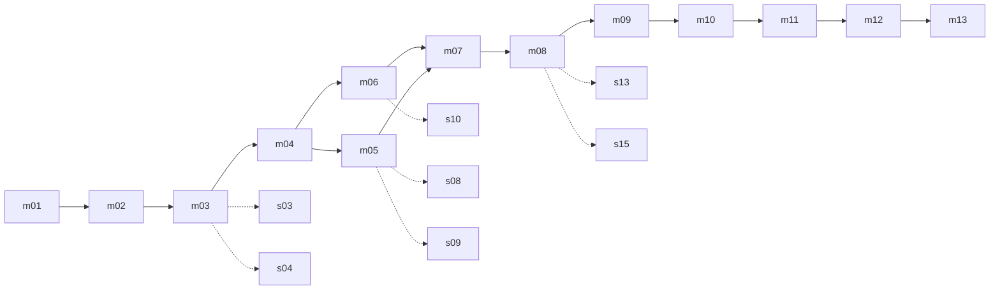

# Eldmark: story bible

The story that the quests of [quests.md](quests.md) tell: what really happened in the Sundering, who the Hollow are,
the antagonist of the endgame, the six acts of each realm, the Echoes of Eld that reveal the truth, the tone guide and
the complete example of Act I in Hondal. For the world itself, its realms and its history as the player starts out, see
[world.md](world.md); this document is **what the player discovers, not what they know at the beginning**.

> Status: **pending the user's confirmation (P3).** The bible below is the integrated proposal. It is complete enough
> to produce the first slice (Hondal, Act I) and it is reviewed in Spanish on the bilingual sheet of
> [quests.md](quests.md) section 13.3 before any of it ships. Nothing in the first slice depends on Acts II-VI beyond
> the hooks listed in section 6.

Whatever carries a number (levels, quantities, rewards) is **provisional**, like the rest of the phase 6-8 documents.

## 0. Decisions

| # | Decision | Why |
|---|---|---|
| S1 | The truth of the Sundering is the **Oath of the Three Bloods** broken when the three lineages touched the Flame at once (section 1) | It gives all three realms a share of the blame and keeps the war fair: nobody is right |
| S2 | The Hollow are the **Oathbound**: the royal garrison that swore to guard the Flame for all three | It explains why they hold the neutral forts and come where an Ember falls (Ember Rain) |
| S3 | **Seneschal Corvan** is the common PvE antagonist for levels 45-60 and leads the Oathbound | It gives the Hollow, Ember Rain and Aldcor a purpose without breaking the rule of "no diplomacy" between realms |
| S4 | Each realm has an **internal antagonist** who, without knowing it, hands Embers to the Seneschal; Act VI reveals they all worked for him | The endgame is shared, the road there is not |
| S5 | The ending of a realm is not peace: the realm learns the truth and claims the Crown anyway | The war goes on in Eldrun, the max-level content, and the irony is the tone: "a shared past that only one can inherit" |
| S6 | **Six acts** per realm, mapped to the zone bands: I 1-10, II 10-20, III 20-32, IV 32-45, V 45-55, VI 55-60 | One act per world band, as in [world.md](world.md) |
| S7 | Linear story with cosmetic choice flags; no voices; serious tone without gore | Quests D18, D19 |
| S8 | The story is never blocked by the war: every war beat has a PvE alternative | Quests D10 |
| S9 | Acts V and VI share structure between the realms (same objectives, own givers and texts) | About 40 % less cost |

## 1. The truth of the Sundering

The common core. It starts from the history in [world.md](world.md); this is what the player pieces together.

- The Flame of Eld was bound by the **Oath of the Three Bloods**: "no blood alone". When the last king died, the three
  lineages touched the Flame **at the same time**, each to keep it for itself. The Oath broke and the Flame exploded.
  The three realms blame the other two; all three are right and none of them is.
- The **Hollow** are the **Oathbound**: the royal garrison that swore to guard the Flame for all three. Tied to the
  Embers, half alive, they carry out their last order: to prevent any one blood from holding the Flame. That is why
  they guard the neutral forts and come to wherever an Ember falls (the Ember Rain).
- **Seneschal Corvan**, keeper of the Oath, commands them. He wants to gather every Ember and rekindle the Flame under
  the old Oath: an eternal Eld in which the three peoples would be Oathbound. He is the common PvE antagonist.
- Each realm has an **internal antagonist** that, unknowingly, is handing Embers to the Seneschal. In Act VI it is
  discovered that all three worked for him.
- The end of each realm is not peace: the realm knows the truth and decides to claim the Crown regardless. The war
  continues in Eldrun, and the irony is the tone: "a shared past that only one can inherit".

## 2. The three realms

### 2.1 Vardheim, "The Last Guard"

Theme: the shame of the Squires who failed; duty against fate; redeeming oneself by finishing the guard.

- **Internal antagonist:** the **Forsworn**, who believe Vardheim will only be freed of its guilt by handing the Embers
  to the Seneschal. Their hidden head is **Jarl Sten Hrafnsson** (Acts II-IV) and their lieutenant in Hondal is
  **Hjalmar**.
- **Allies:** **Jarla Ragnhild** (regent chosen by the council), **Torvald** (veteran of the Wall), **Sigrun** (seer of
  the Embers) and **Marshal Eydis** (Wolf Gate).
- **Ending:** "the Squires keep the Crown until a worthy king rises": the Crown for a king chosen by the council.

### 2.2 Solmarch, "The Broken Dawn"

Theme: luminous faith turned fanaticism; mercy against purity.

- **Internal antagonist:** **Inquisitor Maelis** of the Order of the Dawn, who burns the "Ember-touched" and keeps the
  Embers as relics.
- **Allies:** **Brother Anselm** (healer monk), **Dame Ysolde** (knight errant) and the **abbess of Lirien**.
- **Ending:** the Flame is divine and must be "purified", even at the cost of the world.

### 2.3 Askarra, "The Burning Land"

Theme: survival at any cost; the price of keeping a dying land alive.

- **Internal antagonist:** the **Forge Consortium** and its magnate **Ilkan Daresh**, who sells Askarra's future for
  Embers.
- **Allies:** **Zenaida** (guardian of the water of Thal), **Kassian** (miners' guild) and the strategist
  **Theodora** (Ash Gate).
- **Ending:** the Crown as a contract: the Flame to heal the land, and let the others pay.

## 3. The six acts

Each act is tied to a level band and a world band, not to a zone name. The bands are those of [world.md](world.md) and
the zone table below; the names of the zones are the ones the bands have today and can move without rewriting the acts.

| Act | Levels | Zones (Vardheim / Solmarch / Askarra) | Vardheim: "The Last Guard" | Solmarch: "The Broken Dawn" | Askarra: "The Burning Land" | War moment |
|---|---|---|---|---|---|---|
| I | 1-10 | Hondal / Amber Fields / Thal Oasis (Z1) | Hondal and Isenholm: the Hollow wake; the Forsworn dig at Eldhald; the first Ember | Amber Fields and Valcorin: the harvest feast, the ash plague, pilgrim Hollow, the Inquisitor arrives | Thal Oasis and Kassar: the oasis dries up, the Ember pumps fail, the Hollow assault the Well Ember | Baptism of Fire (Vado Gris, level 10) |
| II | 10-20 | Skarven / Lirien Forest / Ruhn Canyons (Z2) | Shipwrecks with Ember cargo; smuggling through Eldrun; Jarl Sten divides the clans; first dungeon (D1, Ossuaries of Eld) | Abbeys; purges of the "Ember-touched"; the dungeon under the abbey | Miners' strike; Ember mining causes tremors; the dungeon in the mines | Entry to Eldrun (level 20) |
| III | 20-32 | Grimfell / Morvel Marsh / Ash Waste (Z3) | The barrows of the first Squires; the Echo shows they abandoned the king's chamber; the First Squire | The founders of the Dawn tried a "False Sun" with Embers and poisoned the marsh | The cracks are the veins of the Flame; the Consortium wants to drink from the Sundering | War commissions |
| IV | 32-45 | Hrimvald Glacier / Vaucelle Heights / Qesh Salt Flats (Z4) | The Forsworn sabotage the Frost Wall's far reaches; the Seneschal's herald offers a pact; the glacier gate | The Heights: the Order's relic vaults; the first trial of the Dawn's "purification" | The Salt Flats: caravans of Embers sold to the Consortium; siege weapons (GUE-25) | First siege of a castle |
| V | 45-55 | The borders: Wolf March / Penitent Plains / Ossar Forges | The Sundering: the Oath, the Oathbound and the origin of the Seneschal | Same, seen from Solmarch | Same, seen from Askarra | Borders war thread |
| VI | 55-60 | Eldrun and Aldcor | Aldcor: the Seneschal tries to rekindle the Flame with the Embers the three antagonists gave him; the last Echo; the claim | Same | Same | Aldcor (GUE-31) |

The dungeons tied to the acts are shared by the three realms (one map, one entrance per realm): D1 Ossuaries of Eld
(Act II), D2 Sunken Aqueduct (Act III), D3 Oath Archive and D4 Flame Foundry (Act IV), D5 Sundering Roots (Act V) and D6
Last King's Chamber (Act VI).

Volume per act and realm: 12-14 main quests, 15 side quests per zone, 3-5 lore texts per point of interest, one event
per zone and a pool of 6 commissions per board. In Acts V and VI the structure of the quests is shared between the
realms (same objectives, own givers and texts).

## 4. Echoes of Eld

An Echo is a vision granted by touching an Ember: text with a screen effect and no cutscene, seen through the eyes of an
ancestor of the player's realm. There is one main Echo per act and realm (18) and six shared in Acts V-VI (24 in all;
the collection is an achievement, PRG-42).

| Act | What the Echo shows |
|---|---|
| I | The last day: at the gates of Aldcor news arrives that the king is dead |
| II | The three lineages march toward the chamber of the Flame, each on its own |
| III | Each realm's own betrayal: the Squires leave their post; the priests of the Dawn try to drink the Flame; the lords of the forge try to cage it |
| IV | The words of the Oath: "No blood alone" |
| V | The Seneschal's oath: he creates the Oathbound to guard the Flame forever |
| VI | The explosion seen from the Flame: three hands that touch it at once |

## 5. Tone guide

- Serious and tragic, with no gore and no gratuitous cruelty (the target is a PEGI 12 equivalent); dry humor in
  secondary characters (Torvald, Oddvar).
- Every quest answers three things in its description: who asks, why now and what changes if you do it. No "kill 10
  wolves" without a reason.
- In Spanish, address the player as "tú"; the period flavor comes from the vocabulary, not the grammar. Vardheim: short,
  fatalistic sentences. Solmarch: religious rhetoric. Askarra: the language of trade and contract.
- The limits of [quests.md](quests.md) section 7.2 apply; a typical offer is 40-90 words.
- The rival realms are never comic or simply evil: they are the mirror of the player's own.
- Names: invented names stay (Granvik, Hondal, Eldhald); descriptive ones are translated (the Forsworn, the Oathbound).
  The glossary is in [localization.md](localization.md) section 8.2.

## 6. Example: Hondal, Act I (levels 1-10, Vardheim)

The first slice. A new Vardheim character enters Hondal, follows Act I with the NPCs of Granvik, fights four families
(wolves, deserters, the Hollow and the Forsworn) at five points of interest, reaches level 10, travels to Isenholm,
chooses a specialization after its trial and crosses to the Vado Gris for the Baptism of Fire. The Hondal map itself is
in [world.md](world.md) and `docs/zones/hondal.md`.

### 6.1 Places

| Place | Marker id | What is there |
|---|---|---|
| Granvik, the village of pines | `hondal_granvik` | Givers, board, Granvik Pillar, respawn shrine |
| Fang Pines (wolf den) | `hondal_fang_pines` | Wolves, Greyfang (rare) |
| Asbjorn Farm (raided farm) | `hondal_asbjorn_farm` | Clues, wandering Hollow, Kari |
| Deserters' Camp | `hondal_deserter_camp` | Deserters of the Wall, Gunnar Half-Hand |
| Ruins of Eldhald (Ruins of Eld with Hollow) | `hondal_eldhald` | Hollow, the Guardian of Eldhald, the first Ember |
| Sealed Gate of Hrimgard (entrance of a future dungeon) | `hondal_hrimgard_gate` | Shrine of the Forsworn, Hjalmar |
| Passes | `hondal_pass_isenholm`, `hondal_pass_border` | To the capital and to the border |

The Sealed Gate of Hrimgard is a story point of interest, not a dungeon. The provisional pass to the Vardheim camp of the
Vado Gris opens at minimum level 10 ([quests.md](quests.md) D21).

### 6.2 Cast

Named NPCs use ids `hondal_*` and `isenholm_*`. Their look uses the free outfits (Peasant and Ranger) plus dyes and
hairstyles (ART-19).

| NPC | Role | Where |
|---|---|---|
| Ingrid | Reeve of Granvik; main thread | Granvik |
| Torvald | Veteran of the Wall, weapons instructor | Granvik |
| Hilde | Hunter | Granvik / pines |
| Sigrun | Seer of the Embers | Granvik |
| Brann | Smith | Granvik |
| Oddvar | Carter | Road |
| Kari | Asbjorn's son, survivor | Farm |
| Arne and Liv | Miller and his daughter | Mill |
| Yrsa | Old woman | Granvik |
| Ketil | Farmer | Neighboring farm |
| Jarla Ragnhild | Regent of Isenholm | Isenholm, great hall |
| Hakon | Master of the Orders (the Hall of Arms' master at arms); the four role mentors work under him | Isenholm |
| Jarl Ase, Jarl Sten Hrafnsson, Thane Gudrun | The council | Isenholm (market, harbor, barracks) |
| Einar | Steward (capital services) | Isenholm |
| Marshal Eydis | Wolf Gate | Border |

Hostiles: wolf, boar, Hollow, deserter and Forsworn (the families of the bestiary, all humanoid except wolf and boar).
Named: **Greyfang** and **Fencebreaker** (rares), **Gunnar Half-Hand** (named deserter), the **Guardian of Eldhald**
(elite Hollow) and **Hjalmar the Forsworn** (two-phase boss, reinforcements at 50 %, like the Ford Captain).

### 6.3 Main chain: Act I, "The Last Guard: Frost and Ember"

Rewards by the formula of [quests.md](quests.md) section 3.6 (main 0.11 r, finale 0.22 r; gold 0.08 and 0.16 of
`g_ref`, interpolated between band midpoints: 138 g/h up to level 5, about 195 at level 10). XP and gold round half up to a whole number. "Choose" is an item choice.

| Id | Lv | Title (es / en) | Giver → turn-in | Objectives | Teaches | XP / gold | Item |
|---|---|---|---|---|---|---|---|
| m01 | 1 | Llegada a Granvik / Arrival at Granvik | Automatic offer on entry → Ingrid | REACH the square; TALK Ingrid | Move, camera, E | 660 / 11 | n/a |
| m02 | 1 | Acero de escudero / Squire's Steel | Torvald | COMBAT_ACTION on the dummy: 5 light, 2 heavy; 1 dodge; 1 weapon swap (Q) | Combat, free weapons | 660 / 11 | Choose your second weapon (all that exist) |
| m03 | 2 | Lobos en el pinar / Wolves in the Pines | Hilde | KILL 6 `wolf` in the pines; COLLECT 4 pelts (0.6, pity 2) | Blocking and dodging against a pack | 726 / 11 | n/a |
| m04 | 3 | La granja de Asbjorn / The Asbjorn Farm | Ingrid | S1: REACH the farm; INTERACT 3 distinct clues. S2: TALK Kari; KILL 5 `hollow` at the farm | Interacting, stages | 792 / 11 | n/a |
| m05 | 4 | Ceniza de hueso / Bone Ash | Sigrun | COLLECT 5 Hollow ashes (0.5, pity 3); DELIVER to Sigrun; UNLOCK_LORE of Sigrun's vision (points to Eldhald) | Quest drops, Chronicle | 858 / 11 | Choose armor (light, medium, heavy) |
| m06 | 5 | Desertores del Muro / Deserters of the Wall | Ingrid | KILL 8 `deserter`; INTERACT 3 grain sacks; KILL Gunnar Half-Hand; COLLECT his letter (1.0) | Named elite | 924 / 11 | n/a |
| m07 | 6 | La Brasa de Eldhald / The Ember of Eldhald | Sigrun | REACH Eldhald; KILL 8 `hollow`; KILL the Guardian; INTERACT the Ember (3 s channel) → item "Spent Ember" + **Echo I** | The first Ember | 990 / 12 | Choose weapon |
| m08 | 7 | El camino de Isenholm / The Road to Isenholm | Sigrun → Ragnhild | REACH Isenholm (zone handoff); DELIVER the Ember | Zone handoff, the capital | 1 056 / 13 | n/a |
| m09 | 8 | Las tres voces del consejo / Three Voices of the Council | Ragnhild | TALK Jarl Ase (market), Jarl Sten (harbor) and Thane Gudrun (barracks) | Tour of the capital; Sten, suspect (Act II hook) | 1 122 / 14 | n/a |
| m10 | 9 | Los Desjurados / The Forsworn (**close of the PvE part**) | Ragnhild → Torvald | REACH the Sealed Gate; KILL 6 `forsworn`; INTERACT 3 braziers (put out, group credit at 30 m); KILL Hjalmar; COLLECT the Seneschal's letter | Two-phase boss | 1 188 / 15 | Choose a piece, higher rarity |
| m11 | 10 | La Elección del Escudero / The Squire's Choice | Hakon (Hall of Arms) | [quests.md](quests.md) section 11.1: TALK → trial → TALK | Specialization | 1 254 / 16 (+ the trial: 1 368 / 16) | Title and trim |
| m12 | 10 | Al Muro de Escarcha / To the Frost Wall | Torvald → Eydis | S1: REACH the garrison; TALK Eydis. S2 (`any_of` 1): WAR_CAPTURE `vado_gris`; WAR_MERITS 30 in `vado_gris`; KILL 5 fort defenders (Hollow or enemy guards) | The front, RvR | 1 254 / 16 | n/a |
| m13 | 10 | Informe del frente / Report from the Front (**close of Act I**) | Eydis → Ragnhild | TALK Ragnhild (reads the Seneschal's letter) | Act II hook: Skarven | 2 508 / 31 | Choose 1 of 4, higher rarity |

Level milestones (computed with the kills each quest asks for times 1.3, and 12 discovered places; see
[quests.md](quests.md) section 12): m04 delivered at about **4.4**, m07 at **7.2**, m10 at **9.8** (with every side
quest up to level 8 and the discoveries), m11 (The Squire's Choice, minimum level 10) at about **10.3** and m13 at
about **10.9**.

Choices with a flag (S7): in m06, sparing or not the deserter who begs (flag `vdh_spared_deserter`: changes a line of
Torvald and, in Act IV, who helps you in the March); in m10, reading the letter aloud to the council or only to the
Jarla (changes Sten's dialogue in Act II). No branches in the quests.

### 6.4 Side quests (MUN-46)

Rewards at 0.075 r and 0.05 `g_ref` (7 or 8 gold each).

| Id | Lv | Title (es / en) | Giver | Objectives | Place | XP |
|---|---|---|---|---|---|---|
| s01 | 2 | Leña para el invierno / Winter Firewood | Yrsa | GATHER 6 firewood (until PRG-26: INTERACT fallen logs) | Granvik | 495 |
| s02 | 3 | El fuelle de Brann / Brann's Bellows | Brann | CRAFT 1 rivets (until PRG-27: DELIVER 4 scraps from the deserters' crates) | Granvik | 540 |
| s03 | 4 | Colmillo Gris / Greyfang | Hilde | KILL the rare; afterwards the bounty remains (BOUNTY, 20 h) | Pines | 585 |
| s04 | 3 | Pieles para el invierno / Hides for Winter | Hilde | COLLECT 6 boar hides (0.6, pity 2) | Meadows | 540 |
| s05 | 2 | El carro volcado / The Overturned Cart | Oddvar | INTERACT 4 distinct crates by the road (wolves nearby) | Road | 495 |
| s06 | 5 | Cartas sin entregar / Undelivered Letters | Starts with an item (dead mail) | DELIVER 3 letters: TALK three villagers | Road / Granvik | 630 |
| s07 | 6 | La hija del molinero / The Miller's Daughter | Arne | REACH the forest edge; KILL 4 `hollow` next to Liv; TALK Liv | Eldhald edge | 675 |
| s08 | 4 | Piedras que hablan / Stones That Speak | Sigrun | READ 4 rune stones across Hondal | Whole zone (exploration) | 585 |
| s09 | 6 | Sal y hierro / Salt and Iron | Sigrun | USE_ITEM_AT blessed salt on 3 graves; KILL 5 rising Hollow | Graveyard | 675 |
| s10 | 5 | El botín de Gunnar / Gunnar's Hoard | Starts with Gunnar's key | INTERACT the hidden chest (personal) | Camp | 630 |
| s11 | 7 | El santuario del río / The River Shrine | Ingrid | REACH the shrine; INTERACT 3 offerings (group 30 m); KILL 4 looting deserters | River | 720 |
| s12 | 8 | Tablones para la empalizada / Planks for the Palisade | Ingrid | COLLECT 6 planks from carts; INTERACT 3 palisade breaches (introduces the event) | Granvik | 765 |
| s13 | 7 | Oro, acero y bóveda / Gold, Steel and Vault | Einar (Isenholm) | TALK banker, merchant and armorer; ECONOMY buy 1; ECONOMY deposit 1 (until PRG-25: the objective is only to TALK the banker, with no deposit) | Isenholm | 720 |
| s14 | 8 | Rompecercas / Fencebreaker | Ketil | KILL the rare boar (telegraphed charge); afterwards the bounty | Neighboring farm | 765 |
| s15 | 8 | Los nombres de los caídos / Names of the Fallen | A widow (Isenholm) | INTERACT the Wall of Names; READ the list of the Squires; TALK the widow | Isenholm | 765 |

### 6.5 Lore (18 texts in Hondal + 3 in Isenholm = 21)

| Place | Texts |
|---|---|
| Granvik (3) | The founding of the village; the runes of the Pillar; the toast to the Wall |
| Pines (2) | Hilde's hunting notes; the legend of Greyfang |
| Asbjorn Farm (3) | The family's account book; Kari's diary; the gray rags |
| Camp (3) | Gunnar's letter (quest); the list of deserters; a deserter's confession |
| Eldhald (4) | The inscription "No blood alone" (a foretaste); the register of the Oathbound; the Guardian's plaque; **Echo I** |
| Sealed Gate (3) | The runes of the seal; Hjalmar's diary; the Seneschal's letter (quest) |
| Isenholm (3) | The Wall of Names; the laws of the council; the chronicle of the election of the jarls |

### 6.6 Granvik board and the event

The Granvik board draws 3 of these 6 entries per day (see [quests.md](quests.md) section 8.2):

| Entry | Objective | Quantity |
|---|---|---|
| Caza en el pinar / Hunt in the Pines | KILL `wolf` | 8 |
| Huesos inquietos / Restless Bones | KILL `hollow` at Eldhald | 8 |
| Ladrones del Muro / Thieves of the Wall | KILL `deserter` | 8 |
| Resina para las antorchas / Resin for the Torches | GATHER resin (or INTERACT) | 6 |
| Pieles para la curtiduría / Hides for the Tannery | COLLECT hides (0.6, pity 2) | 5 |
| Patrulla del camino / Road Patrol | REACH 3 road markers | 3 |

The event is the **Hollow Incursion** ([quests.md](quests.md) section 9.3): the Hollow come down from Eldhald against the
Granvik Pillar, led by a Hollow Standard-Bearer; success gives "Granvik's Gratitude" and failure closes the merchants.

### 6.7 Chain diagram

### 6.8 Hooks to later acts

m09 plants Jarl Sten as a suspect and m13 carries the Seneschal's letter to the regent: they are the Act II hook (Skarven).
The inscription "No blood alone" and the register of the Oathbound in Eldhald anticipate the Oath of section 1. Nothing
else in Act I depends on the later acts.
